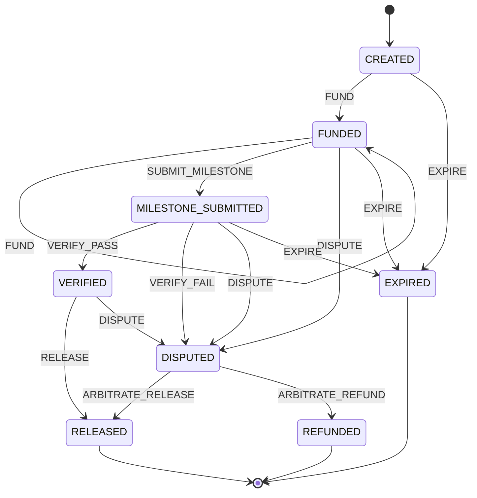

# escrow-state-machine-ts

Deterministic escrow fund-release state machine + campaign fee calculator,
reproduced from the **ALLWEB3** portfolio case study (three-sided Web3 growth
marketplace: creators, campaign managers, governance admins; escrow release
anchored to oracle-verified KPIs).

TypeScript, zero runtime dependencies. The case study's on-chain contracts are
*not* included here — this is the off-chain logic: who can move money, when,
and exactly how the numbers are computed.

## Install

Node.js ≥ 20.

```bash
npm install
npm run build
npm test   # 635 tests, all local
```

## Quickstart

```ts
import { Escrow, calculateDeposit, settleRelease } from "./dist/src/index.js";

// 1. Deterministic fee preview (numbers from the case study)
const fees = calculateDeposit({
  creatorPool: 10000,
  baseFee: 600,
  complexityMultiplier: 1.0,
  loyaltyDiscount: 30,
  oracleFee: 60,
});
console.log(fees.deposit); // 10630

// 2. Milestone escrow lifecycle
const escrow = new Escrow("CMP-2026-042");
escrow.dispatch("FUND", "wire received", 10630); // optional amount: FUND-only,
// validated as a finite non-negative number and recorded on the audit entry
escrow.dispatch("SUBMIT_MILESTONE", "deliverable URLs + IPFS metadata hash");
escrow.dispatch("VERIFY_PASS", "KPIs validated by oracle");
escrow.dispatch("RELEASE");
console.log(escrow.state); // RELEASED

// 3. Gross-to-net settlement on release (5% pro fee)
console.log(settleRelease({ gross: 1000, proFeeBps: 500 }));
// { gross: 1000, proFee: 50, referralCredits: 0, net: 950 }
```

Or run the bundled demo — one command drives a deterministic escrow
through `CREATED → FUNDED → MILESTONE_SUBMITTED → VERIFIED → RELEASED`
(the golden 10,630 deposit, fixed timestamps) and prints the audit
history plus the balanced settlement report. It then runs
`verifyHistoryChain` on that history — the intact, genesis-linked
chain passes — and on a detached copy whose FUND entry's amount is
altered by 1, which fails verification (the stored hash no longer
recomputes), while the escrow's own history stays untouched — then builds the signed
settlement webhook for the released escrow (fixed `eventId`/`at`,
demo-only secret printed in `src/demo.ts` — not a real credential)
and verifies it the way a receiver would. The receiver side then
runs that webhook's `eventId` through `SettlementEventDedupe` on a
fixed clock (1-hour TTL, starting at the webhook's `at`): the first
delivery is new and booked, an immediate redelivery is a duplicate
and skipped, and after the clock advances by exactly the TTL the
same id counts as new again. A second escrow then walks
the dispute branch: `VERIFY_FAIL` into `DISPUTED`, a 2-of-3 arbitrator
quorum collected vote by vote — after the first vote the quorum is
snapshotted, round-tripped through JSON, and restored with
`restoreQuorum` at the identical 1-of-2 count (the arbitration-restart
path), a below-threshold `dispatchArbitration`
attempt is refused with the escrow untouched — and the reached quorum
refunding the sponsor in full to `REFUNDED` with its refund settlement
report. The demo closes with the day-end batch pipeline over all three
escrows (a third escrow is left `FUNDED`): `buildSettlementReports`
builds one report per escrow with per-item error isolation — the
still-`FUNDED` escrow lands as `{escrowId, error}` in the middle of
the batch without blocking the refunded report after it — and
`summarizeSettlementReports` prints the batch's reconciliation
summary (2 reports, 1 error, totals of 21,260 on the two golden
deposits). The batch results then go straight into
`buildSettlementWebhooks`, which signs one webhook per successful
report under the shared demo secret at one fixed batch timestamp —
one factory-generated `eventId` per report (`evt_demo_batch_001`,
`evt_demo_batch_002`, never reused, so a receiver deduplicating on
`eventId` keeps both), the failed entry forwarded as
`{escrowId, error}` — and the demo prints a receiver-side
`verifySettlementWebhook` verdict on each built webhook's line.
The demo closes with a watchdog screening over three further
escrows on one fixed `now`: `staleEscrows` selects by dwell in the
current state (7-day budgets; the escrow funded 17 days earlier is
stale even though its deadline is still ahead) while
`expiredEscrows` selects the same batch by absolute deadline (the
escrow submitted 1 day earlier is expired, not stale) — different
axes, different subsets — and `actOnStaleEscrows` then expires the
one stale escrow with its dispatch pinned to the same fixed `now`,
leaving the other two untouched:

```bash
npm run demo
```

## State machine



(`EXPIRE` is available from `CREATED`, `FUNDED`, and `MILESTONE_SUBMITTED`
once the campaign deadline passes — not from `VERIFIED`/`DISPUTED`, where the
outcome is decided by verification or arbitration; terminal states are
`RELEASED`, `REFUNDED`, `EXPIRED`. The diagram is generated from
`transitionTable()` in `src/stateMachine.ts` by `stateDiagram()` — do not
edit it by hand; regenerate it with `npm run diagram` (prints the block to
stdout; `node dist/src/diagram.js --check` exits 1 if the README copy
drifts; `--write <file>` writes bare mermaid source for standalone `.mmd`
use). `test/stateDiagram.test.ts` asserts edge parity and
`test/diagram.test.ts` guards the generator and CLI.)

- `transition(state, event)` is a pure function; invalid transitions throw.
- `Escrow` wraps it with an append-only history (the case study's "immutable
  operational audit log"): every dispatch records seq, event, from → to,
  timestamp, and an optional note. Each entry is also **hash-chained**:
  `prevHash` links to the previous entry's `hash` (genesis links to the
  `"GENESIS"` constant) and `hash` is SHA-256 over the canonical entry
  serialization, so a rewritten entry in a persisted JSON snapshot is
  detectable — `verifyHistoryChain(history)` returns `false`, and
  `Escrow.fromJSON()` rejects a broken chain, and `buildSettlementReport()`
  verifies the chain before producing any accounting (legacy hashless
  snapshots are still accepted and chained on rehydration; mixed
  chained/hashless snapshots are rejected). By default the chain is unkeyed tamper *evidence*, not a
  MAC — see [SECURITY.md](SECURITY.md) for the honest limits. An optional
  keyed mode upgrades it to a real MAC: construct the escrow with
  `new Escrow(id, { auditKey })` and every link becomes HMAC-SHA256 under
  that key, so a full-log rewrite with recomputed hashes is detected
  without the key. Verification is fail-closed across modes (a keyed
  chain needs its key via `verifyHistoryChain(history, key)` /
  `Escrow.fromJSON(snapshot, { auditKey })`; an unkeyed chain rejects a
  supplied key), and the key is never written into snapshots.
  `FUND` accepts an optional `amount`
  argument — it is validated as a finite non-negative number at the dispatch
  boundary (anything else throws) and recorded on the audit entry; passing an
  amount with any other event throws. `FUND` from `CREATED` is the initial
  deposit; `FUND` from `FUNDED` is a self-loop that adds a top-up to the
  locked total — real escrows often need extra collateral, and the locked
  total is always the *sum* of every `FUND` entry's amount (see
  `depositAmountFromHistory`).
- `allowedEvents(state)` lists valid next events for UI gating.
- `transitionTableJson()` exports the whole transition table as canonical
  JSON; `test/__snapshots__/transitionTable.snapshot.json` is the committed
  snapshot (`test/transitionSnapshot.test.ts` fails if the table ever
  changes without regenerating it).
- Retry safety: `dispatch` accepts a fourth argument `opts` with an optional
  `idempotencyKey` (non-empty string). A dispatch whose key was already seen
  is a no-op — it returns the *current* state and appends nothing to the
  audit history, so a retried `FUND` can never double-count the deposit.
  Keys are global to the escrow instance (the same key on a different event
  is still a duplicate), are recorded only after a *successful* dispatch (a
  failed dispatch leaves the key unused, so the caller can retry with
  corrected input), and ARE part of `toJSON()`/`fromJSON()` snapshots: the
  consumed set rides along as `idempotencyKeys` (written only when
  non-empty, so a keyless snapshot keeps its legacy shape), and a restored
  escrow still treats an already-consumed key as a duplicate — replays stay
  exactly-once across restarts as long as snapshots are persisted through
  `toJSON()`. This is per-escrow retry protection, not a distributed
  idempotency store: two processes restoring the same snapshot
  independently can each execute the same key once.
- Injectable audit timestamps: `dispatch` opts also accept `at`
  (`Date | string`) to pin the audit entry's timestamp — for deterministic
  dispatch tests and replay (quorum approvals and webhook payloads already
  had injectable clocks; the audit clock did not). A `Date` is normalized
  via `toISOString()`; a string must already be canonical ISO-8601 (the
  same rule snapshot validation enforces) and must not be earlier than the
  previous entry's `at`. Invalid or backwards values throw before anything
  is appended, and a rejected dispatch consumes no idempotency key. When
  omitted, the wall clock is used as before. The injected value is covered
  by the entry's hash chain like every other field.
- Deposit caps: `new Escrow(id, { maxDeposit })` caps the total locked
  deposit at a finite non-negative number (risk control / contract limits).
  A `FUND` whose amount would push the locked total — the sum of every
  `FUND` entry's amount — above the cap throws a `deposit cap exceeded`
  error *after* transition and amount validation and appends nothing, so a
  failed FUND leaves no audit residue. `FUND` dispatches without an amount
  carry no money and are never capped. The cap is
  per-instance constructor configuration: it is NOT part of
  `toJSON()`/`fromJSON()` snapshots, so a restored escrow must re-enable it
  via `Escrow.fromJSON(snapshot, opts)`.
- Event-level RBAC (opt-in): `new Escrow(id, { rolePolicy })` maps events
  to the actor names allowed to dispatch them, e.g.
  `{ RELEASE: ["treasury"], ARBITRATE_RELEASE: ["dao-arbitrator"] }`.
  `dispatch` then requires `opts.actor` (a non-empty string, recorded on
  the audit entry and covered by its hash chain) to exactly match the
  allowlist for gated events — a missing or non-allowlisted actor throws
  `actor not authorized for …` after the transition-legality check and
  before anything is appended, and does not consume an idempotency key,
  so a retry with an authorized actor and the same key succeeds. Events
  the policy does not list are unrestricted, and an escrow with no policy
  behaves exactly as before. Invalid policies (unknown event, non-array
  value, empty array, empty/non-string actor name) throw
  `invalid option: rolePolicy …` at construction. Unlike the deposit
  cap, the policy IS part of `toJSON()`/`fromJSON()` snapshots
  (`rolePolicy`, only when non-empty; a tampered policy in a stored
  snapshot is rejected), and an explicit
  `Escrow.fromJSON(snapshot, { rolePolicy })` overrides the snapshot's
  policy entirely. Honest limit: this is a *caller-supplied allowlist*,
  not identity authentication — the caller asserts the actor string and
  nothing verifies who the caller is (see SECURITY.md).
- Optimistic concurrency (opt-in): `dispatch` opts accept `expectedSeq`
  — the history length (the last entry's `seq`; `0` for an empty
  history) the caller based its decision on. When set, the guard runs
  before every other dispatch check (option validation, the
  idempotency dedupe, transition legality, RBAC, amount/cap): a
  mismatch throws
  `dispatch conflict: expected seq <n> but escrow is at seq <m>` and
  changes nothing — no state move, no history entry, no idempotency
  key consumed, no listener notified — so two writers racing off the
  same snapshot cannot both advance the escrow, and the loser can
  re-read and retry with the fresh seq. A non-integer or negative
  value throws `invalid dispatch options: …`. Honest limit: this is a
  single-process optimistic lock only; two processes that each
  restored the same snapshot can still race, and cross-process writers
  need compare-and-swap in the durable store itself.
- Deadlines (advisory): `escrow.setDeadline(date)` attaches a deadline
  (stored as canonical ISO-8601; unparseable input throws),
  `getDeadline()`/`clearDeadline()` read and remove it. The deadline is
  *advisory*: nothing auto-expires — a watchdog (or a human) reads
  `isOverdue(escrow)` and dispatches `EXPIRE` explicitly, so expiry stays
  auditable in the append-only history. `isOverdue()` returns false with
  no deadline and for terminal states (a settled escrow is never
  "overdue"). `expiredEscrows(escrows)` filters a batch down to the
  overdue non-terminal ones in one line — it never mutates or dispatches.
  `expireOverdueEscrows(escrows)` goes one step further and performs the
  explicit `EXPIRE` dispatch per overdue escrow, returning per-escrow
  `{ escrow, expired, error? }` outcomes. The executor exists because of a
  real trap: `VERIFIED` (and `DISPUTED`) escrows have no `EXPIRE` edge in
  the transition table, so a naive hand-written loop aborts the whole
  batch on the first such escrow — the executor records
  `{ expired: false, error: "invalid transition: EXPIRE from VERIFIED" }`
  for it and keeps going. Failed escrows are left untouched.
  The deadline rides along in `toJSON()`/`fromJSON()` snapshots (a
  tampered or non-canonical deadline is rejected by snapshot validation).
  A distinct screening is `staleEscrows(escrows, maxAgeByState, now?)`:
  where the deadline helpers ask "past an *absolute* deadline", it asks
  "stuck in the *current state* too long" — dwell is measured from the
  last history entry's `at`, against a per-state millisecond budget,
  and an escrow is stale only when dwell is *strictly* past its state's
  budget (terminal states never qualify, states with no budget are
  ignored, and an escrow with no history has no measurable dwell). A
  FUNDED escrow whose milestone nobody submits for 30 days is picked
  up here even when its deadline is months away. It is a pure filter;
  its executor companion is `actOnStaleEscrows(escrows, action,
  maxAgeByState, now?)`, which runs a caller-supplied action for each
  stale escrow and returns per-escrow `{ escrow, acted, error? }`
  outcomes, isolating failures so one unactionable escrow never
  aborts the batch. There is deliberately *no default* action: expiry
  is the single obvious action for an overdue escrow, but a stale
  escrow's right disposition — notify the parties, escalate to
  arbitration, or expire it — is a state-dependent caller decision,
  so the action is a required argument.
- Dispatch subscriptions (in-process fan-out seam): `escrow.subscribe(listener)`
  registers a listener called with `(event, from, to, entry)` after every
  *successful* dispatch, in subscription order; the returned function
  unsubscribes (idempotent). Listeners run *after* the audit entry is
  appended and can never roll it back — a throwing listener is isolated
  (its error is swallowed, remaining listeners still run, dispatch returns
  normally); pass `{ onError }` to observe those failures. The entry handed
  to listeners is a frozen, detached copy, so listeners cannot rewrite the
  audit trail. Failed dispatches and idempotency-key no-ops produce zero
  notifications. Subscriptions are in-memory only: they are NOT part of
  `toJSON()`/`fromJSON()` snapshots, and there is no durable fan-out
  (queues, webhooks, retries) — that stays the caller's infrastructure.
- Persistence-ready snapshots: `escrow.toJSON()` exports a plain-JSON
  `{ v, id, state, history }` snapshot (a detached deep copy;
  `JSON.stringify(escrow)` goes through it), and
  `Escrow.fromJSON(snapshot)` rebuilds a working escrow — the input is
  strictly validated as if untrusted (seq restarts at 1 with no gaps,
  from→to chain continuous from `CREATED`, every edge a legal transition,
  canonical ISO-8601 non-decreasing timestamps, `amount` finite and
  non-negative on FUND entries only); malformed snapshots throw a
  descriptive `invalid snapshot: …` error instead of yielding a corrupt
  escrow. Unknown fields are rejected fail-closed at both levels —
  top level allows only `v`/`id`/`state`/`history`/`deadline`/`idempotencyKeys`/`rolePolicy` and an
  entry only `seq`/`event`/`from`/`to`/`at`/`actor`/`note`/`amount`/`evidence`/
  `prevHash`/`hash` — so a typo like `deadlline` or `amout` throws
  `invalid snapshot: unknown field "…"` instead of silently losing a
  deadline or a FUND amount. Snapshots carry a schema version (`v: 1`): a missing `v` is a
  legacy pre-versioning snapshot and is still accepted, while any other
  `v` value throws `unsupported snapshot version` (checked before the
  history/hash-chain validation), so a future format change stays
  distinguishable from corruption. The consumed idempotency-key set is
  part of the snapshot (`idempotencyKeys`, only when non-empty; entries
  must be non-empty strings and duplicates are deduped on restore) —
  `v` stays 1 because the field is optional and additive: snapshots
  without it load exactly as before, but a snapshot *carrying* it is
  rejected as an unknown field by older parsers that predate it (an old
  binary must not silently drop replay protection). A snapshot is an *export*, not a datastore — there is still no
  built-in storage or locking.
- History-only restore (event sourcing): `Escrow.fromHistory(id, history)`
  rebuilds a working escrow from a *bare* audit history — the history is
  the only source of truth and the state is derived from its last entry
  (an empty history rebuilds a fresh `CREATED` escrow), so a holder of a
  bare log (e.g. the receiving end of the NDJSON transport below) no
  longer has to hand-wrap entries in a snapshot envelope with a state
  field it derived itself. Validation is the exact `parseEscrowHistory`
  code path (seq/chain/edge/timestamp rules, hash chain re-verified with
  `auditKey` when keyed); legacy hashless histories are chained on
  rehydration exactly as in `fromJSON`, and a rebuilt escrow keeps
  dispatching with no seq gap. Options re-attach as in
  `fromJSON(snapshot, opts)` (`requireVerifyEvidence`/`maxDeposit`/
  `auditKey`/`rolePolicy`) — with one honest difference: a snapshot
  *carries* its `rolePolicy`, so there the option overrides stored
  state, while a bare history carries no policy, so here the option is
  the only source. What a bare history cannot restore at all: the
  deadline, the consumed idempotency-key set, and subscriptions live
  only in the envelope / in memory, so a `fromHistory` rebuild starts
  with no deadline, an *empty* key set (a key consumed before the log
  was taken would re-execute), and zero listeners — use `fromJSON`
  when those must survive a restart.
- NDJSON audit-log streaming: `historyToNdjson(history | escrow)` /
  `historyFromNdjson(text)` (`src/ndjson.ts`) export and import *only
  the audit log* — one canonical JSON entry per line, line order =
  `seq` order, trailing newline, empty history exports to `""`. Use a
  snapshot when you need state + configuration restored; use NDJSON
  when the log itself should stream to disk or a log pipeline.
  Import is as strict as the snapshot parser (it runs through
  `parseEscrowHistory`, the same code path): seq from 1 with no gaps,
  from/to chain continuous, the hash chain re-verified — a tampered,
  deleted, or reordered line throws, a non-JSON line throws naming
  its 1-based line number, and empty/whitespace-only input throws
  (a missing log is not a log of zero events). CRLF input is
  accepted. Keyed (HMAC) histories need the same `auditKey` on
  import, and the key never appears in the text. Imported entries feed
  `Escrow.fromHistory(id, entries)` directly when a working escrow —
  not just the log — is what the receiving end needs.

## FAQ (honest)

- **Is this a smart contract?**
  No. This is pure TypeScript with zero runtime dependencies, running on
  Node.js ≥ 20. It reproduces the *off-chain* transition rules from the
  ALLWEB3 portfolio case study. There is no Solidity, no EVM bytecode, and
  no on-chain state here.

- **Where does the fee formula come from?**
  From the case study's "Deterministic Fee Calculator & Escrow Preview":
  `deposit = creatorPool + baseFee × complexityMultiplier − loyaltyDiscount + oracleFee`.
  The golden vector (10,000 / 600 / 1.0 / −30 / +60 → 10,630) is asserted by
  `test/economics.test.ts`. It is the case study's formula, not a general
  pricing engine.

- **The case study anchors settlement in Chainlink + zk-SNARK + TEE
  verification. Where is that here?**
  It isn't — deliberately. "Verification" here is the `VERIFY_PASS` event:
  dispatching it is a caller trust decision. This repo does *not* verify
  oracle signatures, zero-knowledge proofs, or TEE attestations. A production
  build would have to gate `VERIFY_PASS` on those.

  What *is* supported is an auditable opt-in: `new Escrow(id, {
  requireVerifyEvidence: true })` makes `dispatch("VERIFY_PASS")` require a
  non-empty `evidence` reference (Chainlink request ID, zk proof commitment,
  TEE quote hash — passed via `DispatchOptions.evidence`) and records it
  verbatim on the audit entry, surviving `toJSON()`/`fromJSON()` round-trips.
  It turns "someone said pass" into "someone said pass, citing X" — the
  reference is auditable but still *not* verified by the library. The flag
  is per-instance dispatch configuration and is not part of the snapshot;
  a restored escrow must re-enable it via `Escrow.fromJSON(snapshot, opts)`.

- **What about the 5/9 multi-sig DAO arbitration?**
  Partially modeled: `DISPUTE` → `ARBITRATE_RELEASE` /
  `ARBITRATE_REFUND` are the arbitration outcomes, and `src/quorum.ts`
  models the *counting rule* of an M-of-N quorum (`createQuorum({ threshold,
  signers })`, idempotent `approve()`, `revoke()` before the threshold is
  reached, `hasQuorum()` — see the usage example
  in its JSDoc). `approvalLog()` records who approved and when
  (timestamps injectable via `QuorumConfig.now` for deterministic tests).
  An optional `maxApprovalAgeMs` gives approvals a shelf life: past the
  window (boundary inclusive) they stop counting toward the threshold —
  `hasQuorum()` can fall back to false — but they stay in `approvalLog()`,
  and re-approving records a fresh timestamp; revoking an expired
  approval is allowed and removes its entries. `src/arbitration.ts` wires the two together:
  `dispatchArbitration(escrow, quorum, outcome)` refuses to dispatch until
  `hasQuorum()` is true and auto-records `quorum <approvals>/<threshold>`
  in the audit note; an optional final argument forwards an injectable
  audit timestamp / actor to the arbitration entry (the same `at` /
  `actor` the plain dispatch accepts). A quorum's collected approvals can survive a
  process restart: `quorum.snapshot()` exports the full approval log
  plus the configuration it was collected under as plain JSON, and
  `restoreQuorum(config, snapshot)` restores it under strict
  validation (unknown signers, duplicate entries, bad timestamps, and
  config mismatches are rejected; expiry keeps aging from the original
  timestamps, never refreshed by the restore). The snapshot is an
  export format, not a built-in store, and restored approvals are
  still unsigned. There is still no signature verification, no key
  management, and no DAO governance in this repo — recording approvals is a
  caller trust decision, exactly like `VERIFY_PASS`. Production would need
  the approvals wired to real signatures.

- **How precise is the money math?**
  All amounts are rounded to cents (`round2`). Invariant tests assert fund
  conservation within ±1 cent. This is not big-decimal arithmetic and has
  not been audited.

- **Can I use this in production?**
  No. `Escrow` is in-memory with no built-in store (snapshots are a JSON
  export via `toJSON()`/`Escrow.fromJSON()`, not a database), no concurrency
  control beyond the single-process `expectedSeq` optimistic guard on
  `dispatch` (cross-process writers still need store-level
  compare-and-swap), idempotency keys that persist only inside each escrow's own
  snapshot (no shared/distributed store),
  `EXPIRE` is dispatched by the caller — there is an advisory deadline
  field plus `isOverdue()`/`expiredEscrows()` watchdog helpers and an
  `expireOverdueEscrows()` batch executor (which skips escrows with no
  legal `EXPIRE` edge instead of aborting the batch), but no
  background timer or auto-expiry — and there is no identity
  authentication: the opt-in `rolePolicy` RBAC is only a
  caller-supplied actor allowlist (the caller asserts the actor
  string; nothing verifies who they are).
  Reference and demo use only.

## Limitations (honest)

- **Off-chain reproduction only.** The case study anchors settlement in smart
  contracts (Chainlink + zk-SNARK + TEE verification, 5/9 Safe multi-sig
  arbitration). None of that is implemented here — this models the *rules*,
  not the chain.
- **Simplified roles.** This repo now has opt-in event-level RBAC
  (`rolePolicy`: a caller-supplied actor allowlist, persisted in
  snapshots), but real deployments still need identity authentication
  on top of it (the library cannot verify who an actor really is), a real deadline
  scheduler (this repo has an advisory deadline field with
  `isOverdue()`/`expiredEscrows()` watchdog helpers plus an
  `expireOverdueEscrows()` batch executor, but no background
  timer or auto-expire), and a shared/distributed idempotency store
  (this repo's consumed keys persist only inside each escrow's own
  snapshot); the `Escrow` class is in-memory.
- **Fee formula is the case study's**, not a general pricing engine: arbitrary
  fee schedules are out of scope.
- **Trust boundaries.** What the library enforces (money input validation,
  fail-closed constant-time webhook verification, strict snapshot validation)
  versus what stays the caller's responsibility (quorum approvals have no
  signature verification, webhook secret distribution, cents-rounding money
  math) is documented in [SECURITY.md](SECURITY.md) — every statement there
  is verifiable against the source.

## Webhooks

Settled escrows can be pushed to accounting/bookkeeping systems as signed
webhook notifications:

```ts
import {
  buildSettlementReport,
  buildSettlementWebhook,
  verifySettlementWebhook,
} from "escrow-state-machine-ts";

const report = buildSettlementReport({ /* escrowId, history, finalState, deposit, settlement */ });
const { payload, signature } = buildSettlementWebhook(report, { secret: process.env.WEBHOOK_SECRET! });
// POST payload as JSON with header `X-Signature: signature` (shape: `sha256=<hex>`).

// On the receiving end, verify over the raw body bytes:
const ok = verifySettlementWebhook(rawBody, receivedSignature, secret);
```

`payload` is `{ event: "escrow.settled", eventId, escrowId, outcome, releasePath?, deposit, parties, at }`,
derived entirely from the audit-backed settlement report. The comparison is
constant-time (`timingSafeEqual`); malformed signatures fail closed as
`false`, never throw.

`releasePath` is present only on `released` payloads: it is the report's
release path copied verbatim (e.g. `"VERIFY_PASS → RELEASE"` for the normal
path, `"DISPUTE → ARBITRATE_RELEASE"` for an arbitration release), so a
receiver can route arbitration settlements to manual review without
re-querying the settlement report. `refunded`/`expired` payloads omit the
key entirely. It sits between `outcome` and `deposit` in the canonical key
order and is covered by the signature — tampering with or stripping it
fails verification.

`eventId` is the receiver's idempotency key: every build generates a fresh
UUID v4 (inject your own via `BuildWebhookOptions.eventId` for deterministic
tests), and the signature covers it, so tampering with it fails verification.
Retries of the same notification reuse the original `eventId`; two
independent settlements never share one. Store seen `eventId`s on the
receiving end and drop duplicates — that is how you tell "retry re-send"
apart from "second settlement":

```ts
import { SettlementEventDedupe } from "escrow-state-machine-ts";

const dedupe = new SettlementEventDedupe({ ttlMs: 24 * 60 * 60_000 }); // defaults: 1h TTL, 10_000 entries
// in the webhook handler, after verifySettlementWebhook(rawBody, sig, secret):
if (dedupe.checkAndRecord(payload.eventId)) {
  return { status: 200, note: "duplicate delivery" };
}
// ... process the settlement exactly once
```

For a whole batch, `buildSettlementWebhooks(buildSettlementReports(inputs), { secret })` pipes the batch report results straight into signed webhooks — one `{ escrowId, webhook }` per settled escrow, an `{ escrowId, error }` per failed entry (forwarded untouched, never blocking later entries), a shared secret and `now`, and a distinct `eventId` per settlement via `eventIdFactory` (default `crypto.randomUUID()`), so receivers deduplicating on `eventId` never drop a settlement as an apparent duplicate.

`checkAndRecord(eventId)` returns `false` on first sighting and `true`
for a repeat within the TTL ("true = is a replay"); at exactly `ttlMs`
the record has expired and the id counts as unseen again, and a
duplicate hit never extends the window. At capacity, expired entries
are reclaimed before the least recently seen entry is evicted.
Illegal configuration (`ttlMs` not a positive finite number,
`maxEntries` not a positive integer) throws at construction, and an
empty or non-string `eventId` throws instead of silently passing.
`size` and `stats()` (`{ size, hits, misses, evictions }`) expose
observability, and `clear()` resets both. Honest limit: the store is
single-process and in-memory only — two receiver processes cannot see
each other's records, so a multi-process receiver must deduplicate
over shared storage (a database unique constraint, Redis, …) instead.

A single process can still carry its ids across its own restart:
`exportSnapshot()` returns a detached, JSON-serializable
`{ v: 1, entries: [eventId, seenAtMs][] }` of the entries still live
against the store's clock, and `SettlementEventDedupe.restore(snapshot, opts)`
(alias `fromSnapshot`) rebuilds a store from it:

```ts
// before shutdown:
persist(JSON.stringify(dedupe.exportSnapshot()));
// at startup:
const dedupe2 = SettlementEventDedupe.restore(JSON.parse(saved), { ttlMs: 24 * 60 * 60_000 });
```

Restore validates strictly — a wrong version, a non-array `entries`,
a malformed entry, or an unknown top-level field throws instead of
silently disabling deduplication. Entries already expired are dropped
at load, an over-`maxEntries` snapshot evicts the oldest `seenAtMs`
first, and TTLs keep counting from each id's original first-seen time
— restoring never grants a fresh window. The `hits`/`misses`/
`evictions` counters are not part of the snapshot: a restored store
starts them at zero. The snapshot bridges one process across its own
restart only; two processes restoring the same snapshot afterwards
diverge, so it is not a substitute for shared storage.

Secret rotation: while you roll from an old secret to a new one, pass both
as candidates — any candidate that matches verifies, all-mismatch still
fails closed:

```ts
const ok = verifySettlementWebhook(rawBody, receivedSignature, {
  secrets: [process.env.WEBHOOK_SECRET_NEW!, process.env.WEBHOOK_SECRET_OLD!],
});
```

An empty `secrets` array (or an empty secret inside it) is a caller
configuration error and throws instead of silently passing. The library does
not generate, store, or schedule the rotation itself — it only accepts the
candidate set the caller hands it (see [SECURITY.md](SECURITY.md)).

Signatures don't expire by themselves: a legitimately-signed payload from a
year ago still verifies. For an opt-in replay bound, pass `maxAgeMs` — the
signature is checked first, and only if it matches is `payload.at` checked
against the window (an unparseable `at` fails closed as `false`):

```ts
// Reject replays older than 5 minutes; `now` is injectable in tests.
const ok = verifySettlementWebhook(rawBody, receivedSignature, {
  secrets: [process.env.WEBHOOK_SECRET!],
  maxAgeMs: 5 * 60 * 1000,
  now: Date.now(), // optional; defaults to the real clock
});
```

`maxAgeMs` alone leaves the future direction unbounded: a
legitimately-signed payload issued far into the future (a sender clock
set wrong or fast) would gain a near-unbounded replay window. Pass
`maxFutureSkewMs` to bound that direction too:

```ts
const ok = verifySettlementWebhook(rawBody, receivedSignature, {
  secrets: [process.env.WEBHOOK_SECRET!],
  maxAgeMs: 5 * 60 * 1000,
  maxFutureSkewMs: 60 * 1000,
  now: Date.now(), // optional; defaults to the real clock
});
// => false when the signature is valid but payload.at - now > maxFutureSkewMs
```

It is enforced only after the signature matches, fails closed as
`false`, and its boundary is likewise inclusive (a skew of exactly
`maxFutureSkewMs` passes); an illegal value throws the same style of
configuration error as `maxAgeMs`. Together the two fields form a
two-sided freshness window. Left unset, `maxFutureSkewMs` changes
nothing — far-future timestamps still pass, exactly as before — and
neither bound replaces deduplication on `eventId`.

Delivery is handled by `deliverSettlementWebhook(url, webhook, options)` —
still zero runtime dependencies (Node ≥ 20 global `fetch`):

```ts
import { deliverSettlementWebhook } from "escrow-state-machine-ts";

const result = await deliverSettlementWebhook(
  "https://ledger.example.com/hooks/escrow",
  { payload, signature },
  { retries: 3, backoffMs: 1000, timeoutMs: 10000, maxRetryDelayMs: 60000 }, // all optional; these are the defaults
});
// result: { status: 200, attempts: 1 }

// Cancel a delivery stuck in retries or a hung request:
const controller = new AbortController();
const pending = deliverSettlementWebhook(url, { payload, signature }, {
  retries: 5,
  signal: controller.signal, // aborts the in-flight request and any backoff sleep
});
controller.abort(); // pending rejects with `webhook delivery aborted`, never retried
```

Semantics: the payload is POSTed as JSON with the `X-Signature` header,
byte-identical to what `buildSettlementWebhook` signed so the receiver can
verify it over the raw body. 2xx returns `{ status, attempts }`; 429, 5xx,
and network errors (including timeouts) are retried with exponential backoff
(retry n waits `backoffMs * 2^(n-1)`). A 429 `Retry-After` response header
(delay seconds or an HTTP-date) takes precedence over the backoff; an
absent or unparsable value falls back to it. The honored hint is clamped to
`maxRetryDelayMs` (default 60,000ms): a faulty or hostile server returning
`Retry-After: 31536000` can never stall the delivery promise beyond the cap. Other 3xx/4xx throw
immediately without retrying, and redirects are never followed: a 3xx
response is returned as-is (the signed payload is never re-posted to a
third-party redirect target), surfacing as `failed with status 301 (not
retried)` so the caller fixes the endpoint URL. When every attempt fails, the error reads
`webhook delivery to <url> failed after <n> attempts: <last cause>`; a
per-attempt timeout surfaces as `timed out after <timeoutMs>ms`. An optional
`signal` (`AbortSignal`) aborts both the in-flight request and any pending
backoff sleep — the promise rejects with `webhook delivery aborted` and the
request is never retried after an abort (an abort is a caller request to
stop, not a retryable failure). Secret
distribution remains the caller's responsibility: whoever holds it can forge
signatures.

Multi-endpoint fan-out is included too:
`deliverSettlementWebhookToMany(report, endpoints)` delivers ONE
settlement event concurrently to every endpoint — the shape where
accounting, notifications, and reconciliation systems must all hear
about the same settlement at once, each holding its own secret:

```ts
import { deliverSettlementWebhookToMany } from "escrow-state-machine-ts";

const out = await deliverSettlementWebhookToMany(report, [
  { url: "https://ledger.example.com/hooks/escrow", secret: ledgerSecret },
  { url: "https://notify.example.com/hooks/escrow", secret: notifySecret },
]);
// out: { results: SettlementWebhookEndpointResult[], delivered: number, failed: number }
// results[i] corresponds to endpoints[i], in input order, and
// delivered + failed always equals endpoints.length.
```

The payload body is built once from the report — one shared `eventId`,
one shared `at` — and signed independently per endpoint with that
endpoint's own secret (one endpoint's secret cannot verify another's
delivery). Each endpoint is delivered through
`deliverSettlementWebhook` itself, so the retry/backoff/`Retry-After`
semantics above apply unchanged, with retry budgets counted per
endpoint; an endpoint can also override `retries`/`backoffMs`/
`timeoutMs`/`maxRetryDelayMs`/`signal` for itself. One endpoint's
failure — retries exhausted, network error, even an invalid URL or an
empty secret — marks only that endpoint's result
`{ ok: false, attempts, status?, error }` and never blocks the others.
Call-level configuration errors still throw before any request: an
empty/non-array `endpoints` list, invalid global delivery options, or
an invalid shared `now`/`eventId`.

Honest limit: there is no durable queue. If the process dies
mid-fan-out, some endpoints may have received the event and others
not — the caller reconciles by re-delivering and letting receivers
deduplicate on the shared `eventId` (see the receiver-side dedupe
example above).

For a whole batch of escrows, `buildSettlementReports(inputsList)` takes
the same per-escrow inputs as `buildSettlementReport` and returns one
`{ escrowId, report }` or `{ escrowId, error }` result per input, in input
order — a non-terminal escrow or a corrupted history fails only its own
entry, never the whole batch, and building reports mutates nothing.
`summarizeSettlementReports(results)` aggregates such a batch into one
reconciliation summary — per-outcome counts, error count, total locked
deposit, total inflow/outflow, and per-party net totals — summing the
already cent-rounded figures from each report (aggregates are `round2`
as well); error entries are counted but never enter the money totals,
and an empty batch yields an all-zero summary.

## Reproducibility

`npm test` runs 635 tests, including the portfolio's exact fee numbers as a
golden vector (10,000 / 600 / 1.0x / −30 / +60 → 10,630). No network; the
only randomness asserted is that two generated `eventId`s differ (UUID v4),
everything else is deterministic.

## Benchmarks

`npm run bench` measures locally-observed throughput for the hot
paths (3000 timed iterations per op after 200 warmup, printing the Node
version and CPU): hash-chained `dispatch`, `verifyHistoryChain`,
event-sourced replay (`Escrow.fromHistory` rebuilding a live escrow
from the same detached 4-entry history, full validation and chain
re-verification on every call),
release settlement netting (`settleRelease` over 4 fixed
representative inputs — the golden 10,630 at 500 bps, 1,000 at
500 bps with 100 referral credits, a large gross of 1,000,000 at
250 bps with 1,250.25 credits, and a 10-at-125-bps half-cent
rounding edge — each checked against hand-computed proFee / net
expectations on every iteration),
`buildSettlementReport`,
settlement report rendering (`renderReport` over the fixed golden
released report — deposit 10,630, released via
VERIFY_PASS → RELEASE, 4 party rows — with the rendered text
checked against hand-written expected lines — header / outcome,
the deposit formula line, and the creator net row — on every
iteration),
funded-total summation (`depositAmountFromHistory` over a fixed
4-shape corpus — a single FUND of the golden 10,630, a two-FUND
top-up sequence summing to 12,630, a FUND recorded without an
amount, and an empty no-FUND history — with the two totals checked
against hand-pinned expectations and both fail-fast shapes checked
against their exact error messages on every iteration),
`buildSettlementReports` (batch),
`summarizeSettlementReports` (batch summary over the batch path's
4 pre-built results — 3 reports + 1 error — aggregating outcome
counts, deposit / inflow / outflow totals, and per-party nets),
`buildSettlementWebhooks` (batch webhook building over the same
4 pre-built results — 3 signed webhooks with distinct deterministic
`eventId`s plus the 1 forwarded per-item error, every built webhook
re-verified on every iteration),
settlement webhook build/verify,
`Retry-After` parsing (`parseRetryAfter` over a fixed 11-value
corpus — delay-seconds, a fractional value, a whitespace-padded
value, zero, future and past HTTP-dates, signed numbers, a garbage
string, and null / undefined — against one injected fixed instant,
every parsed result checked against hand-pinned expectations on
every iteration), NDJSON
audit-log export/import (`historyToNdjson` / `historyFromNdjson`),
quorum approval to threshold (`createQuorum` approving one
signer at a time with a `hasQuorum()` check after each vote),
quorum snapshot restore (`restoreQuorum` rebuilding a live quorum
from a persisted, JSON round-tripped snapshot of the same
9-signer / threshold-5 quorum carrying 7 recorded approvals —
the restart path that strictly re-validates the snapshot's
signer set, threshold, and every audit-trail entry on every
call, self-checked against hand-written expectations on every
iteration),
settlement webhook fan-out delivery (`deliverSettlementWebhookToMany`
to 4 endpoints through a fake global `fetch` — zero network, so the
number measures fan-out overhead only), settlement event dedupe
(`SettlementEventDedupe.checkAndRecord` duplicate hits cycling over
1,000 pre-recorded `eventId`s under a fixed injected clock),
settlement event dedupe snapshot restore
(`SettlementEventDedupe.restore` rebuilding a receiver-side dedupe
from a persisted, JSON round-tripped snapshot of 1,000 entries
under the same fixed clock — all entries live at load under the
default TTL and capacity, the observability counters restarting
at zero; the restored ids are checked exhaustively once outside
the timed loop — all 1,000 judged duplicates, an unseen id keeping
first-sighting semantics — and spot-checked (first / middle /
last) on every iteration), and
watchdog screening (`expiredEscrows` / `staleEscrows` over one fixed
mixed batch of 100 escrows at a fixed screening instant — 40
hand-counted past-deadline non-terminal escrows, 70 hand-counted stale
under FUNDED 7d / MILESTONE_SUBMITTED 30d budgets — with every
screening result checked against the hand-counted expected id list on
every iteration), and
watchdog execution (`expireOverdueEscrows` /
`actOnStaleEscrows` with an `EXPIRE`-dispatch action over fresh
rebuilds of that same 100-escrow batch on every iteration, because
the executors mutate their inputs — 40 of 40 expire attempts and
70 of 70 stale actions succeed, since both selected states carry
an `EXPIRE` edge — with result ids, success flags, post-states,
and the appended `EXPIRE` audit entries checked against the
hand-counted expectations on every iteration; the fresh-fixture
rebuild cost is inside these two rows' timed region, unlike the
pure screening rows above), and
allowed-events lookup (`allowedEvents` over all 8 states of the
transition table — one pass queries every state once in
declaration order, CREATED through EXPIRED, with each result
checked against its hand-pinned expected event list in
declaration order and the three terminal states — RELEASED,
REFUNDED, EXPIRED — expecting the empty list — on every
iteration), and
fee calculation (`calculateDeposit` over a fixed 3-shape corpus —
the golden vector (pool 10,000 / base 600 / complexity 1.0 /
loyalty 30 / oracle 60 → deposit 10,630), a complexity-1.5 case
(pool 5,000 / base 800 / loyalty 50 / oracle 40 → adjusted 1,200,
deposit 6,190), and a large-pool case (pool 1,000,000 / base
2,500 / complexity 2.25 / loyalty 500 / oracle 250 → adjusted
5,625, deposit 1,005,375) — with each returned `adjustedBaseFee`
and `deposit` checked against hand-computed expectations on
every iteration).
Fixtures are deterministic — one escrow driven through the full
`CREATED → RELEASED` lifecycle (4 hash-chained audit entries, golden
deposit 10,630), with a fixed webhook secret, payload timestamp, and
`eventId`; the batch path runs one fixed batch of 4 inputs
(released / refunded / released, each a 4-entry history, plus one
deliberately mismatched input that must land as a per-item error);
the NDJSON paths use a second fixed history of 8 chained
entries (the golden deposit funded in five staged FUND dispatches,
then milestone, verification, and release); the quorum path uses a
fixed 9-signer set with threshold 5 on a fixed injected clock; the
restore path reuses that shape, snapshotting a quorum with 7
approvals (dao-1..dao-7, one second apart on a stepped fixed
clock) and restoring the JSON round-tripped snapshot; the dedupe
restore path restores a JSON round-tripped snapshot of 1,000 fixed
ids (`bench-restore-0000`..`bench-restore-0999`, all first seen at
the restore instant on a fixed clock) under the default TTL and
capacity; the
watchdog paths screen one fixed batch of 100 escrows (30 past-deadline
FUNDED, 20 in-budget-deadline FUNDED, 10 fresh FUNDED, 10
past-deadline MILESTONE_SUBMITTED, 10 fresh MILESTONE_SUBMITTED, 10
terminal RELEASED with a past deadline, and 10 deadline-less FUNDED);
the watchdog execution paths rebuild that same batch fresh on every
iteration (the executors dispatch `EXPIRE` and append audit entries,
so no batch can be reused); the
allowed-events path needs no fixture beyond the transition table
itself — all 8 states in declaration order with hand-pinned
expected event lists; the
fee-calculation path needs no fixture beyond its 3 fixed input
shapes with hand-computed expectations.
One real run on 2026-10-15:

| path | throughput |
|------|------------|
| dispatch (full lifecycle, 4 dispatches) | ~10,700 ops/sec (~93.2 µs/op) |
| verifyHistoryChain (4 entries) | ~7,600 ops/sec (~131.8 µs/op) |
| Escrow.fromHistory (4 entries) | ~6,800 ops/sec (~147.8 µs/op) |
| settleRelease (4 fixed inputs) | ~363,300 ops/sec (~2.75 µs/op) |
| buildSettlementReport (4 entries) | ~20,200 ops/sec (~49.6 µs/op) |
| renderReport (released report, 4 parties) | ~280 ops/sec (~3,568.3 µs/op) |
| depositAmountFromHistory (4-shape corpus) | ~4,900 ops/sec (~202.9 µs/op) |
| buildSettlementReports (batch 4 x 4 entries) | ~1,800 ops/sec (~554.0 µs/op) |
| summarizeSettlementReports (batch 4 results) | ~62,200 ops/sec (~16.1 µs/op) |
| buildSettlementWebhooks (batch 4 results) | ~4,800 ops/sec (~208.0 µs/op) |
| buildSettlementWebhook (sign) | ~21,900 ops/sec (~45.7 µs/op) |
| verifySettlementWebhook | ~38,700 ops/sec (~25.8 µs/op) |
| parseRetryAfter (11-value corpus) | ~82,800 ops/sec (~12.1 µs/op) |
| historyToNdjson (8 entries) | ~3,200 ops/sec (~317.3 µs/op) |
| historyFromNdjson (8 entries, chain re-verify) | ~2,000 ops/sec (~504.7 µs/op) |
| quorum approve to threshold (5 of 9) | ~47,800 ops/sec (~20.9 µs/op) |
| restoreQuorum (snapshot, 7 approvals of 9) | ~1,800 ops/sec (~549.0 µs/op) |
| deliverSettlementWebhookToMany (4 endpoints, fake fetch) | ~1,100 ops/sec (~945.9 µs/op) |
| SettlementEventDedupe checkAndRecord (hit, 1,000 recorded ids) | ~187,300 ops/sec (~5.34 µs/op) |
| SettlementEventDedupe.restore (1,000-entry snapshot) | ~553 ops/sec (~1,809.0 µs/op) |
| expiredEscrows (batch 100 escrows) | ~6,000 ops/sec (~167.1 µs/op) |
| staleEscrows (batch 100 escrows) | ~5,800 ops/sec (~172.3 µs/op) |
| expireOverdueEscrows (batch 100 escrows, fresh fixture) | ~205 ops/sec (~4,886.0 µs/op) |
| actOnStaleEscrows (batch 100 escrows, fresh fixture) | ~245 ops/sec (~4,089.1 µs/op) |
| allowedEvents (all 8 states) | ~665,800 ops/sec (~1.50 µs/op) |
| calculateDeposit (3-shape corpus) | ~140,500 ops/sec (~7.12 µs/op) |

Environment: Node v24.20.0, linux/x64, AMD EPYC 9D25 126-Core
Processor (virtualized; shared host, so numbers vary run to
run). This run was taken on a 2-core host with load average
≈8.5 (1-minute) to ≈8.6 (15-minute); repeated runs swing
individual rows widely in both directions (some by an order of
magnitude), so treat the table as this run's measurements, most
useful for same-run relative comparison, not as a regression
signal.
Machine-local measurements for capacity planning, not guaranteed
throughput — run `npm run bench` on your own hardware.

## License

MIT
