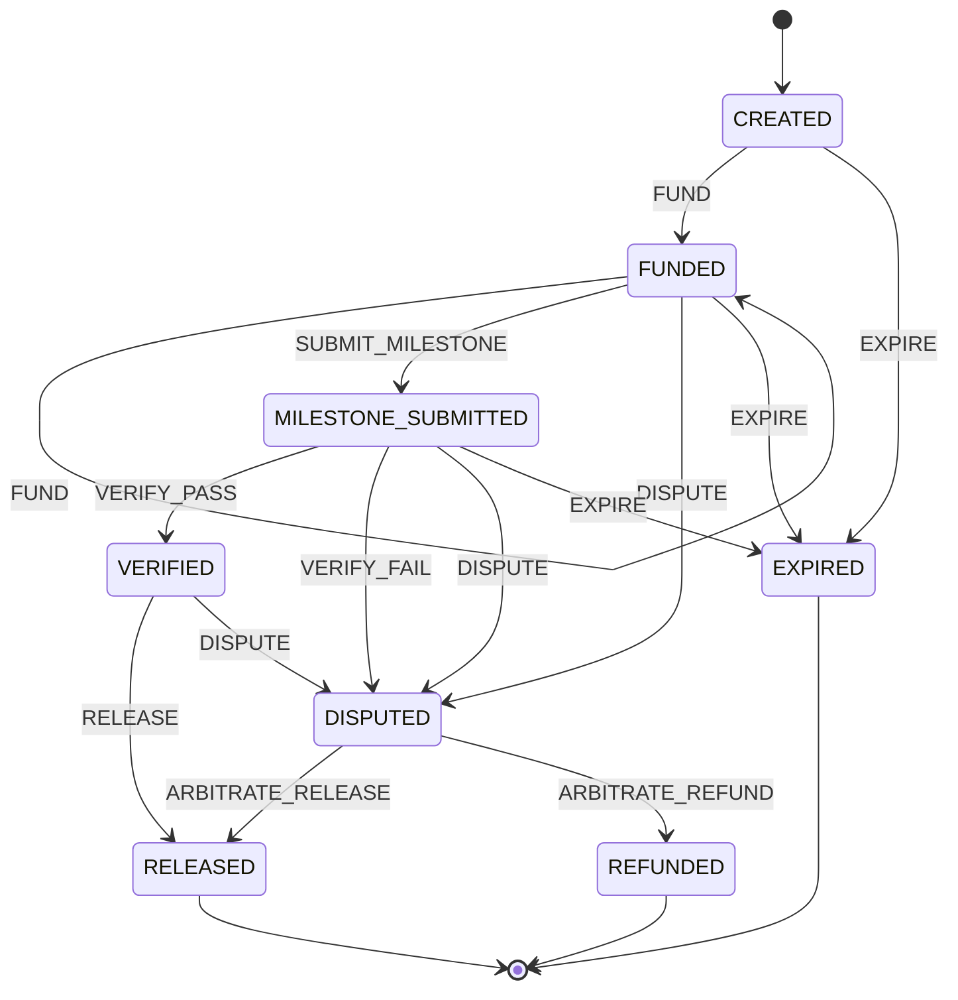

# escrow-state-machine-ts

Deterministic escrow fund-release state machine + campaign fee calculator,
reproduced from the **ALLWEB3** portfolio case study (three-sided Web3 growth
marketplace: creators, campaign managers, governance admins; escrow release
anchored to oracle-verified KPIs).

TypeScript, zero runtime dependencies. The case study's on-chain contracts are
*not* included here — this is the off-chain logic: who can move money, when,
and exactly how the numbers are computed.

## Install

Node.js ≥ 20.

```bash
npm install
npm run build
npm test   # 984 tests, all local
```

## Quickstart

```ts
import { Escrow, calculateDeposit, settleRelease } from "./dist/src/index.js";

// 1. Deterministic fee preview (numbers from the case study)
const fees = calculateDeposit({
  creatorPool: 10000,
  baseFee: 600,
  complexityMultiplier: 1.0,
  loyaltyDiscount: 30,
  oracleFee: 60,
});
console.log(fees.deposit); // 10630

// 2. Milestone escrow lifecycle
const escrow = new Escrow("CMP-2026-042");
escrow.dispatch("FUND", "wire received", 10630); // optional amount: FUND-only,
// validated as a finite non-negative number and recorded on the audit entry
escrow.dispatch("SUBMIT_MILESTONE", "deliverable URLs + IPFS metadata hash");
escrow.dispatch("VERIFY_PASS", "KPIs validated by oracle");
escrow.dispatch("RELEASE");
console.log(escrow.state); // RELEASED

// 3. Gross-to-net settlement on release (5% pro fee)
console.log(settleRelease({ gross: 1000, proFeeBps: 500 }));
// { gross: 1000, proFee: 50, referralCredits: 0, net: 950 }
```

Or run the bundled demo — one command drives a deterministic escrow
through `CREATED → FUNDED → MILESTONE_SUBMITTED → VERIFIED → RELEASED`
(the golden 10,630 deposit, fixed timestamps) and prints the audit
history plus the balanced settlement report. It then runs
`verifyHistoryChain` on that history — the intact, genesis-linked
chain passes — and on a detached copy whose FUND entry's amount is
altered by 1, which fails verification (the stored hash no longer
recomputes), while the escrow's own history stays untouched — then builds the signed
settlement webhook for the released escrow (fixed `eventId`/`at`,
demo-only secret printed in `src/demo.ts` — not a real credential)
and verifies it the way a receiver would. The receiver side then
runs that webhook's `eventId` through `SettlementEventDedupe` on a
fixed clock (1-hour TTL, starting at the webhook's `at`): the first
delivery is new and booked, an immediate redelivery is a duplicate
and skipped, and after the clock advances by exactly the TTL the
same id counts as new again. The sender side then parses
`Retry-After` hints with `parseRetryAfter` on the same fixed
clock: a fixed corpus (delay-seconds, a whitespace-padded value,
future and past HTTP-dates, a signed value, a garbage string,
and null) is printed value by value — both hint forms normalize
to milliseconds, a past date yields 0, and unparsable or absent
values yield `undefined`, the sender's cue to fall back to
exponential backoff (on a 429 the parsed hint, clamped by
`maxRetryDelayMs`, sets the wait before the next attempt).
A second escrow then walks
the dispute branch: `VERIFY_FAIL` into `DISPUTED`, a 2-of-3 arbitrator
quorum collected vote by vote — after the first vote the quorum is
snapshotted, round-tripped through JSON, and restored with
`restoreQuorum` at the identical 1-of-2 count (the arbitration-restart
path), a below-threshold `dispatchArbitration`
attempt is refused with the escrow untouched — and the reached quorum
refunding the sponsor in full to `REFUNDED` with its refund settlement
report. The demo closes with the day-end batch pipeline over all three
escrows (a third escrow is left `FUNDED`): `buildSettlementReports`
builds one report per escrow with per-item error isolation — the
still-`FUNDED` escrow lands as `{escrowId, error}` in the middle of
the batch without blocking the refunded report after it — and
`summarizeSettlementReports` prints the batch's reconciliation
summary (2 reports, 1 error, totals of 21,260 on the two golden
deposits). The batch results then go straight into
`buildSettlementWebhooks`, which signs one webhook per successful
report under the shared demo secret at one fixed batch timestamp —
one factory-generated `eventId` per report (`evt_demo_batch_001`,
`evt_demo_batch_002`, never reused, so a receiver deduplicating on
`eventId` keeps both), the failed entry forwarded as
`{escrowId, error}` — and the demo prints a receiver-side
`verifySettlementWebhook` verdict on each built webhook's line.
The demo closes with a watchdog screening over three further
escrows on one fixed `now`: `staleEscrows` selects by dwell in the
current state (7-day budgets; the escrow funded 17 days earlier is
stale even though its deadline is still ahead) while
`expiredEscrows` selects the same batch by absolute deadline (the
escrow submitted 1 day earlier is expired, not stale) — different
axes, different subsets — and `actOnStaleEscrows` then expires the
one stale escrow with its dispatch pinned to the same fixed `now`,
leaving the other two untouched. The demo then closes with a
deadline-watchdog section over three more escrows on the same
fixed `now`: `expiredEscrows` screens the batch by deadline and
`expireOverdueEscrows` executes that selection with per-item
isolation — the past-deadline `VERIFIED` escrow has no `EXPIRE`
edge and lands as `{expired: false, error}` without blocking the
past-deadline `FUNDED` escrow after it, which expires, while the
stale-only escrow (deadline still ahead) is never attempted, so
the deadline and stale axes pick disjoint subsets of this batch
too. (The executor pins the fixed screening `now` as each `EXPIRE`
entry's `at`, so the appended entries are deterministic too; the
demo prints no timestamp for them and its printed output stays
deterministic.) The demo
then prints an allowed-events listing that runs
`allowedEvents()` over all 8 states in transition-table order and
prints one line per state — the query an escrow-list UI or a
watchdog consults to decide what an escrow can do next — with the
three terminal states (RELEASED / REFUNDED / EXPIRED) returning
the empty list, and the main escrow's own RELEASED state called
out on its own line as that same empty set. The demo then prints
a deposit-provenance segment: `depositAmountFromHistory`
traces the locked deposit back out of the main escrow's audit
history alone — 10,630, the sum of every FUND amount, matching
the settlement report's deposit — and a fixed copy of that
history with every FUND entry removed fails with the explicit
`settlement requires a FUND amount` error, shown on one FAILED
line (a history that cannot corroborate a deposit settles
nothing, rather than guessing). The demo finally closes with a
settlement-split segment: `settleRelease` splits that same
golden deposit in isolation — gross 10,630 at the main escrow's
500 bps pro fee yields a 531.50 platform fee and a 10,098.50
creator net with zero referral credits, the three parts summing
back to the deposit exactly — the same split the settlement
report above was built on, shown as the pure function's own
input and output:

```bash
npm run demo
```

## State machine



(`EXPIRE` is available from `CREATED`, `FUNDED`, and `MILESTONE_SUBMITTED`
once the campaign deadline passes — not from `VERIFIED`/`DISPUTED`, where the
outcome is decided by verification or arbitration; terminal states are
`RELEASED`, `REFUNDED`, `EXPIRED`. The diagram is generated from
`transitionTable()` in `src/stateMachine.ts` by `stateDiagram()` — do not
edit it by hand; regenerate it with `npm run diagram` (prints the block to
stdout; `node dist/src/diagram.js --check` exits 1 if the README copy
drifts; `--write <file>` writes bare mermaid source for standalone `.mmd`
use). `test/stateDiagram.test.ts` asserts edge parity and
`test/diagram.test.ts` guards the generator and CLI.)

- `transition(state, event)` is a pure function; invalid transitions throw.
- `Escrow` wraps it with an append-only history (the case study's "immutable
  operational audit log"): every dispatch records seq, event, from → to,
  timestamp, and an optional note. Each entry is also **hash-chained**:
  `prevHash` links to the previous entry's `hash` (genesis links to the
  `"GENESIS"` constant) and `hash` is SHA-256 over the canonical entry
  serialization, so a rewritten entry in a persisted JSON snapshot is
  detectable — `verifyHistoryChain(history)` returns `false`, and
  `Escrow.fromJSON()` rejects a broken chain, and `buildSettlementReport()`
  verifies the chain before producing any accounting (legacy hashless
  snapshots are still accepted and chained on rehydration; mixed
  chained/hashless snapshots are rejected). By default the chain is unkeyed tamper *evidence*, not a
  MAC — see [SECURITY.md](SECURITY.md) for the honest limits. An optional
  keyed mode upgrades it to a real MAC: construct the escrow with
  `new Escrow(id, { auditKey })` and every link becomes HMAC-SHA256 under
  that key, so a full-log rewrite with recomputed hashes is detected
  without the key. Verification is fail-closed across modes (a keyed
  chain needs its key via `verifyHistoryChain(history, key)` /
  `Escrow.fromJSON(snapshot, { auditKey })`; an unkeyed chain rejects a
  supplied key), and the key is never written into snapshots. The CLI
  demo (`npm run demo`) walks the keyed mode end to end on a branch
  escrow: the correct key verifies the HMAC-chained history, a wrong
  key and no key both fail closed, and a detached copy with a rewritten
  middle entry fails even under the correct key. The demo's key is a
  fixed printed placeholder, not a real secret — key management stays
  the caller's problem, exactly as in a real deployment.
  `FUND` accepts an optional `amount`
  argument — it is validated as a finite non-negative number at the dispatch
  boundary (anything else throws) and recorded on the audit entry; passing an
  amount with any other event throws. `FUND` from `CREATED` is the initial
  deposit; `FUND` from `FUNDED` is a self-loop that adds a top-up to the
  locked total — real escrows often need extra collateral, and the locked
  total is always the *sum* of every `FUND` entry's amount (see
  `depositAmountFromHistory`).
- `allowedEvents(state)` lists valid next events for UI gating.
- `transitionTableJson()` exports the whole transition table as canonical
  JSON; `test/__snapshots__/transitionTable.snapshot.json` is the committed
  snapshot (`test/transitionSnapshot.test.ts` fails if the table ever
  changes without regenerating it).
- Retry safety: `dispatch` accepts a fourth argument `opts` with an optional
  `idempotencyKey` (non-empty string). A dispatch whose key was already seen
  is a no-op — it returns the *current* state and appends nothing to the
  audit history, so a retried `FUND` can never double-count the deposit.
  Keys are global to the escrow instance (the same key on a different event
  is still a duplicate), are recorded only after a *successful* dispatch (a
  failed dispatch leaves the key unused, so the caller can retry with
  corrected input), and ARE part of `toJSON()`/`fromJSON()` snapshots: the
  consumed set rides along as `idempotencyKeys` (written only when
  non-empty, so a keyless snapshot keeps its legacy shape), and a restored
  escrow still treats an already-consumed key as a duplicate — replays stay
  exactly-once across restarts as long as snapshots are persisted through
  `toJSON()`. This is per-escrow retry protection, not a distributed
  idempotency store: two processes restoring the same snapshot
  independently can each execute the same key once.
- Injectable audit timestamps: `dispatch` opts also accept `at`
  (`Date | string`) to pin the audit entry's timestamp — for deterministic
  dispatch tests and replay (quorum approvals and webhook payloads already
  had injectable clocks; the audit clock did not). A `Date` is normalized
  via `toISOString()`; a string must already be canonical ISO-8601 (the
  same rule snapshot validation enforces) and must not be earlier than the
  previous entry's `at`. Invalid or backwards values throw before anything
  is appended, and a rejected dispatch consumes no idempotency key. When
  omitted, the wall clock is used as before. The injected value is covered
  by the entry's hash chain like every other field.
- Deposit caps: `new Escrow(id, { maxDeposit })` caps the total locked
  deposit at a finite non-negative number (risk control / contract limits).
  A `FUND` whose amount would push the locked total — the sum of every
  `FUND` entry's amount — above the cap throws a `deposit cap exceeded`
  error *after* transition and amount validation and appends nothing, so a
  failed FUND leaves no audit residue. `FUND` dispatches without an amount
  carry no money and are never capped. The cap is
  per-instance constructor configuration: it is NOT part of
  `toJSON()`/`fromJSON()` snapshots, so a restored escrow must re-enable it
  via `Escrow.fromJSON(snapshot, opts)`.
- Event-level RBAC (opt-in): `new Escrow(id, { rolePolicy })` maps events
  to the actor names allowed to dispatch them, e.g.
  `{ RELEASE: ["treasury"], ARBITRATE_RELEASE: ["dao-arbitrator"] }`.
  `dispatch` then requires `opts.actor` (a non-empty string, recorded on
  the audit entry and covered by its hash chain) to exactly match the
  allowlist for gated events — a missing or non-allowlisted actor throws
  `actor not authorized for …` after the transition-legality check and
  before anything is appended, and does not consume an idempotency key,
  so a retry with an authorized actor and the same key succeeds. Events
  the policy does not list are unrestricted, and an escrow with no policy
  behaves exactly as before. Invalid policies (unknown event, non-array
  value, empty array, empty/non-string actor name) throw
  `invalid option: rolePolicy …` at construction. Unlike the deposit
  cap, the policy IS part of `toJSON()`/`fromJSON()` snapshots
  (`rolePolicy`, only when non-empty; a tampered policy in a stored
  snapshot is rejected), and an explicit
  `Escrow.fromJSON(snapshot, { rolePolicy })` overrides the snapshot's
  policy entirely. Honest limit: this is a *caller-supplied allowlist*,
  not identity authentication — the caller asserts the actor string and
  nothing verifies who the caller is (see SECURITY.md).
- Optimistic concurrency (opt-in): `dispatch` opts accept `expectedSeq`
  — the history length (the last entry's `seq`; `0` for an empty
  history) the caller based its decision on. When set, the guard runs
  before every other dispatch check (option validation, the
  idempotency dedupe, transition legality, RBAC, amount/cap): a
  mismatch throws
  `dispatch conflict: expected seq <n> but escrow is at seq <m>` and
  changes nothing — no state move, no history entry, no idempotency
  key consumed, no listener notified — so two writers racing off the
  same snapshot cannot both advance the escrow, and the loser can
  re-read and retry with the fresh seq. A non-integer or negative
  value throws `invalid dispatch options: …`. Honest limit: this is a
  single-process optimistic lock only; two processes that each
  restored the same snapshot can still race, and cross-process writers
  need compare-and-swap in the durable store itself.
- Deadlines (advisory): `escrow.setDeadline(date)` attaches a deadline
  (stored as canonical ISO-8601; unparseable input throws),
  `getDeadline()`/`clearDeadline()` read and remove it. The deadline is
  *advisory*: nothing auto-expires — a watchdog (or a human) reads
  `isOverdue(escrow)` and dispatches `EXPIRE` explicitly, so expiry stays
  auditable in the append-only history. `isOverdue()` returns false with
  no deadline and for terminal states (a settled escrow is never
  "overdue"). `expiredEscrows(escrows)` filters a batch down to the
  overdue non-terminal ones in one line — it never mutates or dispatches.
  `expireOverdueEscrows(escrows)` goes one step further and performs the
  explicit `EXPIRE` dispatch per overdue escrow, returning per-escrow
  `{ escrow, expired, error?, entry? }` outcomes — a successful outcome
  also carries `entry`, a frozen detached copy of the appended EXPIRE
  audit entry, so an expiry operations report can cite it without
  re-reading `escrow.history`; failed outcomes leave it absent. The executor exists because of a
  real trap: `VERIFIED` (and `DISPUTED`) escrows have no `EXPIRE` edge in
  the transition table, so a naive hand-written loop aborts the whole
  batch on the first such escrow — the executor records
  `{ expired: false, error: "invalid transition: EXPIRE from VERIFIED" }`
  for it and keeps going. Failed escrows are left untouched.
  The executor pins the screening `now` as the `at` of every `EXPIRE`
  entry it appends (`dispatch("EXPIRE", …, { at: now })`), so a fixed
  screening instant produces identical audit entries across the batch
  and across replays — the wall clock never leaks in. (Consequence:
  `now` must not predate an escrow's last history entry; a backdated
  `now` lands as a per-escrow `{expired: false, error}` and the batch
  continues.)
  The deadline rides along in `toJSON()`/`fromJSON()` snapshots (a
  tampered or non-canonical deadline is rejected by snapshot validation).
  A distinct screening is `staleEscrows(escrows, maxAgeByState, now?)`:
  where the deadline helpers ask "past an *absolute* deadline", it asks
  "stuck in the *current state* too long" — dwell is measured from the
  last history entry's `at`, against a per-state millisecond budget,
  and an escrow is stale only when dwell is *strictly* past its state's
  budget (terminal states never qualify, states with no budget are
  ignored, and an escrow with no history has no measurable dwell). A
  FUNDED escrow whose milestone nobody submits for 30 days is picked
  up here even when its deadline is months away. It is a pure filter;
  its executor companion is `actOnStaleEscrows(escrows, action,
  maxAgeByState, now?)`, which runs a caller-supplied action for each
  stale escrow and returns per-escrow `{ escrow, acted, error?, entry? }`
  outcomes, isolating failures so one unactionable escrow never
  aborts the batch. A successful outcome also carries `entry`, a
  frozen detached copy of the audit entry the action appended, when
  the action appended one (a notify-only action leaves it absent;
  failed actions leave it absent too). There is deliberately *no default* action: expiry
  is the single obvious action for an overdue escrow, but a stale
  escrow's right disposition — notify the parties, escalate to
  arbitration, or expire it — is a state-dependent caller decision,
  so the action is a required argument.
- Dispatch subscriptions (in-process fan-out seam): `escrow.subscribe(listener)`
  registers a listener called with `(event, from, to, entry)` after every
  *successful* dispatch, in subscription order; the returned function
  unsubscribes (idempotent). Listeners run *after* the audit entry is
  appended and can never roll it back — a throwing listener is isolated
  (its error is swallowed, remaining listeners still run, dispatch returns
  normally); pass `{ onError }` to observe those failures. The entry handed
  to listeners is a frozen, detached copy, so listeners cannot rewrite the
  audit trail. Failed dispatches and idempotency-key no-ops produce zero
  notifications. Subscriptions are in-memory only: they are NOT part of
  `toJSON()`/`fromJSON()` snapshots, and there is no durable fan-out
  (queues, webhooks, retries) — that stays the caller's infrastructure.
- Persistence-ready snapshots: `escrow.toJSON()` exports a plain-JSON
  `{ v, id, state, history }` snapshot (a detached deep copy;
  `JSON.stringify(escrow)` goes through it), and
  `Escrow.fromJSON(snapshot)` rebuilds a working escrow — the input is
  strictly validated as if untrusted (seq restarts at 1 with no gaps,
  from→to chain continuous from `CREATED`, every edge a legal transition,
  canonical ISO-8601 non-decreasing timestamps, `amount` finite and
  non-negative on FUND entries only); malformed snapshots throw a
  descriptive `invalid snapshot: …` error instead of yielding a corrupt
  escrow. Unknown fields are rejected fail-closed at both levels —
  top level allows only `v`/`id`/`state`/`history`/`deadline`/`idempotencyKeys`/`rolePolicy` and an
  entry only `seq`/`event`/`from`/`to`/`at`/`actor`/`note`/`amount`/`evidence`/
  `prevHash`/`hash` — so a typo like `deadlline` or `amout` throws
  `invalid snapshot: unknown field "…"` instead of silently losing a
  deadline or a FUND amount. Snapshots carry a schema version (`v: 1`): a missing `v` is a
  legacy pre-versioning snapshot and is still accepted, while any other
  `v` value throws `unsupported snapshot version` (checked before the
  history/hash-chain validation), so a future format change stays
  distinguishable from corruption. The consumed idempotency-key set is
  part of the snapshot (`idempotencyKeys`, only when non-empty; entries
  must be non-empty strings and duplicates are deduped on restore) —
  `v` stays 1 because the field is optional and additive: snapshots
  without it load exactly as before, but a snapshot *carrying* it is
  rejected as an unknown field by older parsers that predate it (an old
  binary must not silently drop replay protection). A snapshot is an *export*, not a datastore — there is still no
  built-in storage or locking.
- History-only restore (event sourcing): `Escrow.fromHistory(id, history)`
  rebuilds a working escrow from a *bare* audit history — the history is
  the only source of truth and the state is derived from its last entry
  (an empty history rebuilds a fresh `CREATED` escrow), so a holder of a
  bare log (e.g. the receiving end of the NDJSON transport below) no
  longer has to hand-wrap entries in a snapshot envelope with a state
  field it derived itself. Validation is the exact `parseEscrowHistory`
  code path (seq/chain/edge/timestamp rules, hash chain re-verified with
  `auditKey` when keyed); legacy hashless histories are chained on
  rehydration exactly as in `fromJSON`, and a rebuilt escrow keeps
  dispatching with no seq gap. Options re-attach as in
  `fromJSON(snapshot, opts)` (`requireVerifyEvidence`/`maxDeposit`/
  `auditKey`/`rolePolicy`) — with one honest difference: a snapshot
  *carries* its `rolePolicy`, so there the option overrides stored
  state, while a bare history carries no policy, so here the option is
  the only source. What a bare history cannot restore at all: the
  deadline, the consumed idempotency-key set, and subscriptions live
  only in the envelope / in memory, so a `fromHistory` rebuild starts
  with no deadline, an *empty* key set (a key consumed before the log
  was taken would re-execute), and zero listeners — use `fromJSON`
  when those must survive a restart.
- NDJSON audit-log streaming: `historyToNdjson(history | escrow)` /
  `historyFromNdjson(text)` (`src/ndjson.ts`) export and import *only
  the audit log* — one canonical JSON entry per line, line order =
  `seq` order, trailing newline, empty history exports to `""`. Use a
  snapshot when you need state + configuration restored; use NDJSON
  when the log itself should stream to disk or a log pipeline.
  Import is as strict as the snapshot parser (it runs through
  `parseEscrowHistory`, the same code path): seq from 1 with no gaps,
  from/to chain continuous, the hash chain re-verified — a tampered,
  deleted, or reordered line throws, a non-JSON line throws naming
  its 1-based line number, and empty/whitespace-only input throws
  (a missing log is not a log of zero events). CRLF input is
  accepted. Keyed (HMAC) histories need the same `auditKey` on
  import, and the key never appears in the text. Imported entries feed
  `Escrow.fromHistory(id, entries)` directly when a working escrow —
  not just the log — is what the receiving end needs.

## FAQ (honest)

- **Is this a smart contract?**
  No. This is pure TypeScript with zero runtime dependencies, running on
  Node.js ≥ 20. It reproduces the *off-chain* transition rules from the
  ALLWEB3 portfolio case study. There is no Solidity, no EVM bytecode, and
  no on-chain state here.

- **Where does the fee formula come from?**
  From the case study's "Deterministic Fee Calculator & Escrow Preview":
  `deposit = creatorPool + baseFee × complexityMultiplier − loyaltyDiscount + oracleFee`.
  The golden vector (10,000 / 600 / 1.0 / −30 / +60 → 10,630) is asserted by
  `test/economics.test.ts`. It is the case study's formula, not a general
  pricing engine.

- **The case study anchors settlement in Chainlink + zk-SNARK + TEE
  verification. Where is that here?**
  It isn't — deliberately. "Verification" here is the `VERIFY_PASS` event:
  dispatching it is a caller trust decision. This repo does *not* verify
  oracle signatures, zero-knowledge proofs, or TEE attestations. A production
  build would have to gate `VERIFY_PASS` on those.

  What *is* supported is an auditable opt-in: `new Escrow(id, {
  requireVerifyEvidence: true })` makes `dispatch("VERIFY_PASS")` require a
  non-empty `evidence` reference (Chainlink request ID, zk proof commitment,
  TEE quote hash — passed via `DispatchOptions.evidence`) and records it
  verbatim on the audit entry, surviving `toJSON()`/`fromJSON()` round-trips.
  It turns "someone said pass" into "someone said pass, citing X" — the
  reference is auditable but still *not* verified by the library. The flag
  is per-instance dispatch configuration and is not part of the snapshot;
  a restored escrow must re-enable it via `Escrow.fromJSON(snapshot, opts)`.
  The CLI demo (`npm run demo`) walks the gate end to end on branch
  escrows: an evidence-free `VERIFY_PASS` is refused with state and
  history untouched, the same dispatch carrying an evidence reference is
  accepted and recorded verbatim, and a default escrow (flag off) keeps
  the pre-gate behavior. The demo's evidence reference is a fixed string,
  not a verified oracle response — the gate is a caller-side hook shape,
  not a claim that any real oracle or proof was checked.

- **What about the 5/9 multi-sig DAO arbitration?**
  Partially modeled: `DISPUTE` → `ARBITRATE_RELEASE` /
  `ARBITRATE_REFUND` are the arbitration outcomes, and `src/quorum.ts`
  models the *counting rule* of an M-of-N quorum (`createQuorum({ threshold,
  signers })`, idempotent `approve()`, `revoke()` before the threshold is
  reached, `hasQuorum()` — see the usage example
  in its JSDoc). `approvalLog()` records who approved and when
  (timestamps injectable via `QuorumConfig.now` for deterministic tests).
  An optional `maxApprovalAgeMs` gives approvals a shelf life: past the
  window (boundary inclusive) they stop counting toward the threshold —
  `hasQuorum()` can fall back to false — but they stay in `approvalLog()`,
  and re-approving records a fresh timestamp; revoking an expired
  approval is allowed and removes its entries. `src/arbitration.ts` wires the two together:
  `dispatchArbitration(escrow, quorum, outcome)` refuses to dispatch until
  `hasQuorum()` is true and auto-records `quorum <approvals>/<threshold>`
  in the audit note; an optional final argument forwards retry-safety
  metadata to the arbitration entry — an injectable audit timestamp /
  actor (the same `at` / `actor` the plain dispatch accepts) plus an
  `idempotencyKey` (a repeated, e.g. timed-out, arbitration call with the
  same key is a pure no-op instead of an `invalid transition` failure;
  the key is consumed only by a *successful* dispatch — a below-threshold
  rejection never "uses it up", so the caller can gather approvals and
  retry) and an `expectedSeq` optimistic-concurrency guard (a stale seq
  raises `dispatch conflict` loudly instead of no-op'ing through the
  dedupe). A quorum's collected approvals can survive a
  process restart: `quorum.snapshot()` exports the full approval log
  plus the configuration it was collected under as plain JSON, and
  `restoreQuorum(config, snapshot)` restores it under strict
  validation (unknown signers, duplicate entries, bad timestamps, and
  config mismatches are rejected; expiry keeps aging from the original
  timestamps, never refreshed by the restore). The snapshot is an
  export format, not a built-in store, and restored approvals are
  still unsigned. There is still no signature verification, no key
  management, and no DAO governance in this repo — recording approvals is a
  caller trust decision, exactly like `VERIFY_PASS`. Production would need
  the approvals wired to real signatures.

- **How precise is the money math?**
  All amounts are rounded to cents (`round2`). New `dispatch("FUND", …)`
  amounts are normalized to cents at entry — no new dispatch can produce
  a sub-cent amount in the audit trail (legacy snapshots with sub-cent
  amounts are still accepted by the parsers, not re-normalized).
  Finite-but-huge fee inputs that would overflow the deposit computation
  to `Infinity` are rejected: `calculateDeposit` throws
  `deposit computation overflowed: inputs too large` instead of returning
  `{ deposit: Infinity }`, which would poison every downstream settlement
  ledger. Invariant tests assert fund conservation within ±1 cent. This is
  not big-decimal arithmetic and has not been audited.

- **Can I use this in production?**
  No. `Escrow` is in-memory with no built-in store (snapshots are a JSON
  export via `toJSON()`/`Escrow.fromJSON()`, not a database), no concurrency
  control beyond the single-process `expectedSeq` optimistic guard on
  `dispatch` (cross-process writers still need store-level
  compare-and-swap), idempotency keys that persist only inside each escrow's own
  snapshot (no shared/distributed store),
  `EXPIRE` is dispatched by the caller — there is an advisory deadline
  field plus `isOverdue()`/`expiredEscrows()` watchdog helpers and an
  `expireOverdueEscrows()` batch executor (which skips escrows with no
  legal `EXPIRE` edge instead of aborting the batch), but no
  background timer or auto-expiry — and there is no identity
  authentication: the opt-in `rolePolicy` RBAC is only a
  caller-supplied actor allowlist (the caller asserts the actor
  string; nothing verifies who they are).
  Reference and demo use only.

## Limitations (honest)

- **Off-chain reproduction only.** The case study anchors settlement in smart
  contracts (Chainlink + zk-SNARK + TEE verification, 5/9 Safe multi-sig
  arbitration). None of that is implemented here — this models the *rules*,
  not the chain.
- **Simplified roles.** This repo now has opt-in event-level RBAC
  (`rolePolicy`: a caller-supplied actor allowlist, persisted in
  snapshots), but real deployments still need identity authentication
  on top of it (the library cannot verify who an actor really is), a real deadline
  scheduler (this repo has an advisory deadline field with
  `isOverdue()`/`expiredEscrows()` watchdog helpers plus an
  `expireOverdueEscrows()` batch executor, but no background
  timer or auto-expire), and a shared/distributed idempotency store
  (this repo's consumed keys persist only inside each escrow's own
  snapshot); the `Escrow` class is in-memory.
- **Fee formula is the case study's**, not a general pricing engine: arbitrary
  fee schedules are out of scope.
- **Trust boundaries.** What the library enforces (money input validation,
  fail-closed constant-time webhook verification, strict snapshot validation)
  versus what stays the caller's responsibility (quorum approvals have no
  signature verification, webhook secret distribution, cents-rounding money
  math) is documented in [SECURITY.md](SECURITY.md) — every statement there
  is verifiable against the source.

## Webhooks

Settled escrows can be pushed to accounting/bookkeeping systems as signed
webhook notifications:

```ts
import {
  buildSettlementReport,
  buildSettlementWebhook,
  verifySettlementWebhook,
} from "escrow-state-machine-ts";

const report = buildSettlementReport({ /* escrowId, history, finalState, deposit, settlement */ });
const { payload, signature } = buildSettlementWebhook(report, { secret: process.env.WEBHOOK_SECRET! });
// POST payload as JSON with header `X-Signature: signature` (shape: `sha256=<hex>`).

// On the receiving end, verify over the raw body bytes:
const ok = verifySettlementWebhook(rawBody, receivedSignature, secret);
```

`payload` is `{ event: "escrow.settled", eventId, escrowId, outcome, releasePath?, deposit, parties, at }`,
derived entirely from the audit-backed settlement report. The comparison is
constant-time (`timingSafeEqual`); malformed signatures fail closed as
`false`, never throw.

`releasePath` is present only on `released` payloads: it is the report's
release path copied verbatim (e.g. `"VERIFY_PASS → RELEASE"` for the normal
path, `"DISPUTE → ARBITRATE_RELEASE"` for an arbitration release), so a
receiver can route arbitration settlements to manual review without
re-querying the settlement report. `refunded`/`expired` payloads omit the
key entirely. It sits between `outcome` and `deposit` in the canonical key
order and is covered by the signature — tampering with or stripping it
fails verification.

`eventId` is the receiver's idempotency key: every build generates a fresh
UUID v4 (inject your own via `BuildWebhookOptions.eventId` for deterministic
tests), and the signature covers it, so tampering with it fails verification.
Retries of the same notification reuse the original `eventId`; two
independent settlements never share one. Store seen `eventId`s on the
receiving end and drop duplicates — that is how you tell "retry re-send"
apart from "second settlement":

```ts
import { SettlementEventDedupe } from "escrow-state-machine-ts";

const dedupe = new SettlementEventDedupe({ ttlMs: 24 * 60 * 60_000 }); // defaults: 1h TTL, 10_000 entries
// in the webhook handler, after verifySettlementWebhook(rawBody, sig, secret):
if (dedupe.checkAndRecord(payload.eventId)) {
  return { status: 200, note: "duplicate delivery" };
}
// ... process the settlement exactly once
```

For a whole batch, `buildSettlementWebhooks(buildSettlementReports(inputs), { secret })` pipes the batch report results straight into signed webhooks — one `{ escrowId, webhook }` per settled escrow, an `{ escrowId, error }` per failed entry (forwarded untouched, never blocking later entries), a shared secret and `now`, and a distinct `eventId` per settlement via `eventIdFactory` (default `crypto.randomUUID()`), so receivers deduplicating on `eventId` never drop a settlement as an apparent duplicate. A factory bug that repeats an `eventId` is caught in the batch itself: the later report fails as `{ escrowId, error }` with a `duplicate eventId` message, is never signed, and does not block later reports — only successfully signed ids are recorded, so a report whose build fails never claims its id.

`checkAndRecord(eventId)` returns `false` on first sighting and `true`
for a repeat within the TTL ("true = is a replay"); at exactly `ttlMs`
the record has expired and the id counts as unseen again, and a
duplicate hit never extends the window. At capacity, expired entries
are reclaimed before the least recently seen entry is evicted.
Illegal configuration (`ttlMs` not a positive finite number,
`maxEntries` not a positive integer) throws at construction, and an
empty or non-string `eventId` throws instead of silently passing.
`size` and `stats()` (`{ size, hits, misses, evictions }`) expose
observability, and `clear()` resets both. Honest limit: the store is
single-process and in-memory only — two receiver processes cannot see
each other's records, so a multi-process receiver must deduplicate
over shared storage (a database unique constraint, Redis, …) instead.

A single process can still carry its ids across its own restart:
`exportSnapshot()` returns a detached, JSON-serializable
`{ v: 1, entries: [eventId, seenAtMs][] }` of the entries still live
against the store's clock, and `SettlementEventDedupe.restore(snapshot, opts)`
(alias `fromSnapshot`) rebuilds a store from it:

```ts
// before shutdown:
persist(JSON.stringify(dedupe.exportSnapshot()));
// at startup:
const dedupe2 = SettlementEventDedupe.restore(JSON.parse(saved), { ttlMs: 24 * 60 * 60_000 });
```

Restore validates strictly — a wrong version, a non-array `entries`,
a malformed entry, or an unknown top-level field throws instead of
silently disabling deduplication. Entries already expired are dropped
at load, an over-`maxEntries` snapshot evicts the oldest `seenAtMs`
first, and TTLs keep counting from each id's original first-seen time
— restoring never grants a fresh window. The `hits`/`misses`/
`evictions` counters are not part of the snapshot: a restored store
starts them at zero. The snapshot bridges one process across its own
restart only; two processes restoring the same snapshot afterwards
diverge, so it is not a substitute for shared storage.

Secret rotation: while you roll from an old secret to a new one, pass both
as candidates — any candidate that matches verifies, all-mismatch still
fails closed:

```ts
const ok = verifySettlementWebhook(rawBody, receivedSignature, {
  secrets: [process.env.WEBHOOK_SECRET_NEW!, process.env.WEBHOOK_SECRET_OLD!],
});
```

An empty `secrets` array (or an empty secret inside it) is a caller
configuration error and throws instead of silently passing. The library does
not generate, store, or schedule the rotation itself — it only accepts the
candidate set the caller hands it (see [SECURITY.md](SECURITY.md)).

Signatures don't expire by themselves: a legitimately-signed payload from a
year ago still verifies. For an opt-in replay bound, pass `maxAgeMs` — the
signature is checked first, and only if it matches is `payload.at` checked
against the window (an unparseable `at` fails closed as `false`):

```ts
// Reject replays older than 5 minutes; `now` is injectable in tests.
const ok = verifySettlementWebhook(rawBody, receivedSignature, {
  secrets: [process.env.WEBHOOK_SECRET!],
  maxAgeMs: 5 * 60 * 1000,
  now: Date.now(), // optional; defaults to the real clock
});
```

`maxAgeMs` alone leaves the future direction unbounded: a
legitimately-signed payload issued far into the future (a sender clock
set wrong or fast) would gain a near-unbounded replay window. Pass
`maxFutureSkewMs` to bound that direction too:

```ts
const ok = verifySettlementWebhook(rawBody, receivedSignature, {
  secrets: [process.env.WEBHOOK_SECRET!],
  maxAgeMs: 5 * 60 * 1000,
  maxFutureSkewMs: 60 * 1000,
  now: Date.now(), // optional; defaults to the real clock
});
// => false when the signature is valid but payload.at - now > maxFutureSkewMs
```

It is enforced only after the signature matches, fails closed as
`false`, and its boundary is likewise inclusive (a skew of exactly
`maxFutureSkewMs` passes); an illegal value throws the same style of
configuration error as `maxAgeMs`. Together the two fields form a
two-sided freshness window. Left unset, `maxFutureSkewMs` changes
nothing — far-future timestamps still pass, exactly as before — and
neither bound replaces deduplication on `eventId`.

Delivery is handled by `deliverSettlementWebhook(url, webhook, options)` —
still zero runtime dependencies (Node ≥ 20 global `fetch`):

```ts
import { deliverSettlementWebhook } from "escrow-state-machine-ts";

const result = await deliverSettlementWebhook(
  "https://ledger.example.com/hooks/escrow",
  { payload, signature },
  { retries: 3, backoffMs: 1000, timeoutMs: 10000, maxRetryDelayMs: 60000 }, // all optional; these are the defaults
});
// result: { status: 200, attempts: 1 }

// Cancel a delivery stuck in retries or a hung request:
const controller = new AbortController();
const pending = deliverSettlementWebhook(url, { payload, signature }, {
  retries: 5,
  signal: controller.signal, // aborts the in-flight request and any backoff sleep
});
controller.abort(); // pending rejects with `webhook delivery aborted`, never retried
```

Semantics: the payload is POSTed as JSON with the `X-Signature` header,
byte-identical to what `buildSettlementWebhook` signed so the receiver can
verify it over the raw body. Every attempt also carries an `X-Event-Id`
header equal to the payload's `eventId` (the same value on every retry),
so a gateway can deduplicate on the header without parsing the body first.
Every attempt also carries an `Idempotency-Key` header with exactly the
same value, for receivers that deduplicate on the standard payment-gateway
idempotency header rather than on a vendor-specific one; fan-out endpoints
share the same logical eventId, so they share the same header value. Both
headers are transport hints only — neither is covered by the signature,
so a receiver must verify the signature and then trust the body's
`eventId`, never a header, as the deduplication key. 2xx returns
`{ status, attempts }`; 429, 5xx,
and network errors (including timeouts) are retried with exponential backoff
(retry n waits `backoffMs * 2^(n-1)`). Opt-in `jitterMs` (default 0) adds a
`Math.random() * jitterMs` spread on top of each backoff wait, so endpoints
that failed together do not retry in lockstep and thundering-herd the
receiver on restart. This is best-effort de-synchronization only: it does
not guarantee a uniform spread of retries, and it does not coordinate
retries across processes or restarts. A 429 `Retry-After` response header
(delay seconds or an HTTP-date) takes precedence over the backoff; an
absent or unparsable value falls back to it. The honored hint is clamped to
`maxRetryDelayMs` (default 60,000ms): a faulty or hostile server returning
`Retry-After: 31536000` can never stall the delivery promise beyond the cap. Other 3xx/4xx throw
immediately without retrying, and redirects are never followed: a 3xx
response is returned as-is (the signed payload is never re-posted to a
third-party redirect target), surfacing as `failed with status 301 (not
retried)` so the caller fixes the endpoint URL. Plaintext `http:` endpoint
URLs are refused by default with `refusing to POST over plaintext http`
(the signed payload plus the `X-Signature` header are replayable over the
clear): pass `allowInsecureHttp: true` to explicitly opt out for local
loopback/dev servers; `https:` URLs are never gated, and the refusal does
not validate certificates or pin TLS. When every attempt fails, the error reads
`webhook delivery to <url> failed after <n> attempts: <last cause>`; a
per-attempt timeout surfaces as `timed out after <timeoutMs>ms`. An optional
`signal` (`AbortSignal`) aborts both the in-flight request and any pending
backoff sleep — the promise rejects with `webhook delivery aborted` and the
request is never retried after an abort (an abort is a caller request to
stop, not a retryable failure). Secret
distribution remains the caller's responsibility: whoever holds it can forge
signatures.

Multi-endpoint fan-out is included too:
`deliverSettlementWebhookToMany(report, endpoints)` delivers ONE
settlement event concurrently to every endpoint — the shape where
accounting, notifications, and reconciliation systems must all hear
about the same settlement at once, each holding its own secret:

```ts
import { deliverSettlementWebhookToMany } from "escrow-state-machine-ts";

const out = await deliverSettlementWebhookToMany(report, [
  { url: "https://ledger.example.com/hooks/escrow", secret: ledgerSecret },
  { url: "https://notify.example.com/hooks/escrow", secret: notifySecret },
]);
// out: { results: SettlementWebhookEndpointResult[], delivered: number, failed: number, deadlineExceeded: boolean }
// results[i] corresponds to endpoints[i], in input order, and
// delivered + failed always equals endpoints.length.
```

The payload body is built once from the report — one shared `eventId`,
one shared `at` — and signed independently per endpoint with that
endpoint's own secret (one endpoint's secret cannot verify another's
delivery). Each endpoint is delivered through
`deliverSettlementWebhook` itself, so the retry/backoff/`Retry-After`
semantics above apply unchanged, with retry budgets counted per
endpoint; an endpoint can also override `retries`/`backoffMs`/
`timeoutMs`/`maxRetryDelayMs`/`jitterMs`/`signal` for itself. One endpoint's
failure — retries exhausted, network error, even an invalid URL or an
empty secret — marks only that endpoint's result
`{ ok: false, attempts, status?, error }` and never blocks the others.
Call-level configuration errors still throw before any request: an
empty/non-array `endpoints` list, invalid global delivery options, or
an invalid shared `now`/`eventId`.

Fan-out limits: pass `maxEndpoints` to cap the fan-out size (more
endpoints than the cap throws before any request, so one settlement
event cannot turn into an endpoint explosion) and
`overallDeadlineMs` to cap the whole call's wall-clock time. When the
deadline expires, every still-in-flight endpoint is aborted through a
deadline signal composed with that endpoint's own signal — a
per-endpoint `signal` override does not exempt an endpoint from the
deadline — the stopped endpoint reports
`settlement webhook delivery timed out: overall deadline of <ms>ms exceeded`,
endpoints that already completed keep their results, and the
aggregate carries `deadlineExceeded: true`. Both options are
call-level configuration: invalid values throw before any request.

Honest limit: there is no durable queue. If the process dies
mid-fan-out, some endpoints may have received the event and others
not — the caller reconciles by re-delivering and letting receivers
deduplicate on the shared `eventId` (see the receiver-side dedupe
example above).

For a whole batch of escrows, `buildSettlementReports(inputsList)` takes
the same per-escrow inputs as `buildSettlementReport` and returns one
`{ escrowId, report }` or `{ escrowId, error }` result per input, in input
order — a non-terminal escrow or a corrupted history fails only its own
entry, never the whole batch, and building reports mutates nothing.
`summarizeSettlementReports(results)` aggregates such a batch into one
reconciliation summary — per-outcome counts, error count, total locked
deposit, total inflow/outflow, and per-party net totals — summing the
already cent-rounded figures from each report (aggregates are `round2`
as well); error entries are counted but never enter the money totals,
and an empty batch yields an all-zero summary.

For bookkeeping imports, `renderReportCsv(report)` renders the same
report as CSV — the machine-readable counterpart to `renderReport`'s
human-readable text, so an importer never has to parse prose lines:
header `escrowId,outcome,role,inflow,outflow,net`, one row per party in
fixed sponsor/creator/platform/referrer order (zero-amount parties
included, never silently absent), amounts at exactly two decimals with
no thousands separators, and a final `TOTAL` row whose columns are the
sums over the party rows. String fields follow RFC 4180 escaping
(comma/quote/newline fields are quoted, inner quotes doubled), and the
TOTAL row repeats the report's `escrowId`/`outcome` so imports can group
rows back to their escrow. As with the JSON renderer, the CSV renderer
shape-checks its input first: a non-object report, an empty `escrowId`,
an illegal `outcome`, an empty `parties` array, an unknown party role,
or a non-finite party amount throws
`cannot render settlement report as CSV: …` instead of emitting an
`Infinity`/`NaN` row — only the CSV-carried fields are required, so a
parsed `SettlementReportCsv` still re-renders.

`parseSettlementReportCsv(text)` is the inverse for the receiving end of
that hop: it parses the header, the four party rows, and the `TOTAL` row
with an RFC 4180 record parser (quoted fields may carry commas, quotes,
and line breaks), and it cross-checks the document before returning
anything — same `escrowId`/`outcome` on every row, exactly one row per
party role, every amount a finite two-decimal figure, every party `net`
equal to its `inflow − outflow`, and the `TOTAL` row equal to the sums
over the party rows. Anything else throws
`cannot parse settlement report CSV: …`. The return value is a
`SettlementReportCsv`: the CSV-carried subset (`escrowId`, `outcome`,
party ledgers, totals, `balanced`), not a full `SettlementReport` — the
CSV carries no deposit breakdown, settlement parameters, `releasePath`,
`eventCount`, or audit window, and the import does not invent them, so
a parsed value re-renders byte-identically through `renderReportCsv`
but must not be read as the original breakdown. As with the JSON import,
this is structural validation only, not a re-verification of the audit
chain.

For programmatic consumers instead of imports, `renderReportJson(report)`
renders the same report as JSON — `JSON.stringify` of the report itself,
so it carries exactly the `SettlementReport` fields (escrowId, outcome,
releasePath when present, deposit breakdown, settlement when present, the
four party ledgers, totals, balanced flag, and audit window) with no field
added, renamed, or dropped. The one deliberate difference from CSV: amounts
stay JSON numbers (`10098.5`), not two-decimal strings (`"10098.50"`), so
a bookkeeping API or database gets typed money figures rather than text
to re-parse. A value that is not a report at all — or a money figure that
is not finite — throws `cannot render settlement report as JSON: …`
instead of serializing (plain `JSON.stringify` would silently turn
`Infinity`/`NaN` into `null`). `parseSettlementReportJson(text)` is the
inverse for the receiving end of that hop: it applies exactly the same
shape check in the other direction and throws
`cannot parse settlement report JSON: …` on unparseable text, a
non-report JSON value, an empty `escrowId`, an illegal `outcome`, an
empty `parties` array, or a non-finite figure, so a report stored with
`renderReportJson` comes back as a typed `SettlementReport` that
re-renders byte-identically. The three exports therefore cover three
audiences: `renderReport` for humans, `renderReportCsv` for spreadsheet
imports, `renderReportJson` for APIs and storage — and the import is
structural validation only, not a re-verification of the audit chain:
a hand-built document with consistent fields parses, and chain
verification still belongs to `verifyHistoryChain` over the escrow's own
history.

## Reproducibility

`npm test` runs 984 tests, including the portfolio's exact fee numbers as a
golden vector (10,000 / 600 / 1.0x / −30 / +60 → 10,630). No network; the
only randomness asserted is that two generated `eventId`s differ (UUID v4),
everything else is deterministic.

## Benchmarks

`npm run bench` measures locally-observed throughput for the hot
paths (3000 timed iterations per op after 200 warmup, printing the Node
version and CPU): hash-chained `dispatch`, `verifyHistoryChain`
(over the same detached 4-entry history, with the genesis link —
the first entry's `prevHash` is `GENESIS_PREV_HASH` — and every
successor link checked on every iteration, and a detached
tampered copy — the middle `SUBMIT_MILESTONE` entry gaining a
note it never carried — returning `false` once, outside the
timed loop),
single-step transition dispatch (`benchTransition` restoring the
fixed FUNDED snapshot — one FUND entry, the golden 10,630 at the
fixed base instant — on every iteration and dispatching one
`SUBMIT_MILESTONE` step pinned at BASE + 1s, with the restore
cost inside the timed region because dispatch mutates the
escrow; every iteration checks the one-step advance
FUNDED → MILESTONE_SUBMITTED, exactly one appended entry, and a
gap-free seq continuation, and outside the timed loop an
exhaustive pure-`transition()` check pins all 8 states × 9
events — the 14 legal edges returning their hand-pinned targets
and every other pair throwing the exact
`invalid transition: <event> from <state>` message, including
the illegal RELEASE dispatch from FUNDED),
event-sourced replay (`Escrow.fromHistory` rebuilding a live escrow
from the same detached 4-entry history, full validation and chain
re-verification on every call — with the rebuilt escrow's id, state,
and full history checked entry for entry, hashes included,
field-wise and through the canonical NDJSON serializer, on every
iteration, and a detached tampered copy — the FUND amount altered
from 10,630 to 10,631 — rejected with the hash-chain error once,
outside the timed loop),
release settlement netting (`settleRelease` over 4 fixed
representative inputs — the golden 10,630 at 500 bps, 1,000 at
500 bps with 100 referral credits, a large gross of 1,000,000 at
250 bps with 1,250.25 credits, and a 10-at-125-bps half-cent
rounding edge — each checked against hand-computed proFee / net
expectations on every iteration),
`buildSettlementReport`,
settlement report release path (`buildSettlementReport` over the
fixed released history — outcome `released` and `releasePath`
`VERIFY_PASS → RELEASE` checked verbatim on every iteration, the
rendered `Outcome: released (via VERIFY_PASS → RELEASE)` line
pinned once outside the timed loop, a refunded report pinned
outside the timed loop to carry no `releasePath` field, its
webhook serialization pinned to contain no `releasePath` key,
and the released webhook's key order pinned to the canonical
order with `releasePath` between `outcome` and `deposit`),
settlement report audit time window (`buildSettlementReport` over
the same fixed released history — `eventCount` 4 and
`firstEventAt` / `lastEventAt` verbatim
`2026-01-01T00:00:00.000Z` / `2026-01-01T00:00:03.000Z` checked on
every iteration, the rendered
`Audit: 4 events, 2026-01-01T00:00:00.000Z → 2026-01-01T00:00:03.000Z`
line pinned once outside the timed loop, and the degenerate
empty-history shape — `eventCount` 0 with no window endpoints at
all, which the public API fail-fasts on by design, so the shape is
pinned via a hand-built report object — pinned to render exactly
`Audit: 0 events`),
settlement report rendering (`renderReport` over the fixed golden
released report — deposit 10,630, released via
VERIFY_PASS → RELEASE, 4 party rows — with the rendered text
checked against hand-written expected lines — header / outcome,
the deposit formula line, and the creator net row — on every
iteration),
settlement report rendering — refunded + expired (`renderReport`
over two fixed non-released reports: the refunded report over a
4-entry FUND/SUBMIT_MILESTONE/DISPUTE/ARBITRATE_REFUND history —
sponsor inflow = outflow = the full deposit, every party net 0,
no `releasePath` — and the expired report over a 2-entry
FUND/EXPIRE history; both rendered texts checked against
hand-written expected lines — header / outcome, the deposit
formula line, the sponsor and creator rows, the balanced totals
line, and the `Audit:` window line — with the released-only
oracle-fee note line pinned absent, on every iteration),
settlement report CSV rendering (`renderReportCsv` over the same
fixed golden released report — deposit 10,630, released via
VERIFY_PASS → RELEASE, 4 party rows — with the rendered CSV
checked against the hand-written 6 lines — header, one row per
party, and the TOTAL row — and the TOTAL columns re-derived from
the party rows on every iteration, with the mismatched-deposit
construction gate pinned once outside the timed loop: a report
whose deposit disagrees with the FUND total recorded in the audit
history is refused before it can reach the renderer),
settlement report JSON rendering (`renderReportJson` over the same
fixed golden released report — deposit 10,630, released via
VERIFY_PASS → RELEASE, 4 party rows — with the parsed JSON
checked on every iteration against the golden report's amount
fields — escrowId, outcome, releasePath, deposit breakdown, party
ledgers, totals, balanced flag, eventCount — and the creator
inflow pinned as the number 10098.5, not the CSV's two-decimal
text, with a non-finite creator inflow pinned once outside the
timed loop to the exact render error),
settlement report JSON round-trip import
(`parseSettlementReportJson` over the JSON of the same fixed
golden released report — deposit 10,630, released via
VERIFY_PASS → RELEASE, 4 party rows — with the parsed report
checked on every iteration to deep-equal the golden report and
to re-render byte-identically through `renderReportJson`, and
outside the timed loop a parties-less copy pinned to the exact
import error and two parses pinned to independent object graphs),
settlement report CSV round-trip import
(`parseSettlementReportCsv` over the CSV of the same fixed
golden released report — deposit 10,630, released via
VERIFY_PASS → RELEASE, 4 party rows — with the parsed subset
checked on every iteration field for field against the golden
report's CSV-carried fields and re-rendered byte-identically
through `renderReportCsv`, and outside the timed loop a
TOTAL-mismatched copy pinned to the exact import error and two
parses pinned to independent object graphs),
funded-total summation (`depositAmountFromHistory` over a fixed
4-shape corpus — a single FUND of the golden 10,630, a two-FUND
top-up sequence summing to 12,630, a FUND recorded without an
amount, and an empty no-FUND history — with the two totals checked
against hand-pinned expectations and both fail-fast shapes checked
against their exact error messages on every iteration),
`buildSettlementReports` (batch),
`summarizeSettlementReports` (batch summary over the batch path's
4 pre-built results — 3 reports + 1 error — aggregating outcome
counts, deposit / inflow / outflow totals, and per-party nets),
`buildSettlementWebhooks` (batch webhook building over the same
4 pre-built results — 3 signed webhooks with distinct deterministic
`eventId`s plus the 1 forwarded per-item error, every built webhook
re-verified on every iteration),
settlement webhook build/verify,
`Retry-After` parsing (`parseRetryAfter` over a fixed 11-value
corpus — delay-seconds, a fractional value, a whitespace-padded
value, zero, future and past HTTP-dates, signed numbers, a garbage
string, and null / undefined — against one injected fixed instant,
every parsed result checked against hand-pinned expectations on
every iteration), NDJSON
audit-log export/import (`historyToNdjson` / `historyFromNdjson`),
quorum approval to threshold (`createQuorum` approving one
signer at a time with a `hasQuorum()` check after each vote),
quorum snapshot restore (`restoreQuorum` rebuilding a live quorum
from a persisted, JSON round-tripped snapshot of the same
9-signer / threshold-5 quorum carrying 7 recorded approvals —
the restart path that strictly re-validates the snapshot's
signer set, threshold, and every audit-trail entry on every
call, self-checked against hand-written expectations on every
iteration),
quorum snapshot export (`snapshot()` exporting that same
9-signer / threshold-5 quorum carrying 7 recorded approvals —
the checkpoint export an arbitration service pays on every
persist, previously visible only as the restore fixture's
one construction call; the exported envelope is checked
against hand-pinned expectations on every iteration — the
`{ v: 1, ... }` envelope in its pinned key order, threshold 5,
the 9 signers in config order, no `maxApprovalAgeMs` key, and
the 7 approval entries in record order with their pinned
canonical timestamps — and outside the timed loop a
detached-copy mutation is pinned to leave a re-export
unchanged and the JSON round-tripped export is pinned to
restore via `restoreQuorum` into a quorum re-exporting the
restore fixture's persisted snapshot byte-for-byte),
quorum revoke cycle (`revoke()` on a fresh 5/9 quorum —
approve dao-1..dao-5 to the threshold, revoke dao-3 to drop
to 4/5 below it, then re-approve dao-3 to return to 5/5,
with `approvalCount()` / `hasQuorum()` / `approvals()`
checked against hand-pinned expectations at every stage,
the re-approved signer returning last in `approvals()`
order because ordering follows each signer's latest
approval, and the unknown-signer / not-approved revoke
rejections pinned to their exact messages once, outside
the timed loop),
quorum approval expiry (the `maxApprovalAgeMs` counting
views on a fresh 5/9 quorum with a 60-second window on an
advancing injected clock — approvals staggered at BASE,
BASE + 30s, and BASE + 60s, checked while all five count
with dao-1 exactly at the inclusive boundary, then
expiring one at a time as the clock crosses each window,
dao-2 pinned at its own boundary on the way, with
`approvalLog()` pinned at its full 5 entries throughout
— expiry never deletes — and the two expired signers
re-approving to restore the quorum with the log grown to
7; the fully-expired log retention and the re-approval's
fresh timestamp are pinned once, outside the timed loop),
settlement webhook fan-out delivery (`deliverSettlementWebhookToMany`
to 4 endpoints through a fake global `fetch` — zero network, so the
number measures fan-out overhead only),
settlement webhook fan-out per-endpoint `timeoutMs` override
(`deliverSettlementWebhookToMany` to 3 endpoints — one hanging
under a pinned 10 ms per-endpoint `timeoutMs` override, the
other two answering 200 immediately under the call-level
5000 ms — with result order, the pinned timeout text, and the
normal success shapes checked on every iteration, and the
illegal-0 override and no-override shapes pinned once,
outside the timed loop),
settlement webhook single-target delivery (`deliverSettlementWebhook`
to 1 fixed endpoint through a fake global `fetch` answering 200
immediately — zero network, `backoffMs` 0 — with the result
`{ status: 200, attempts: 1 }`, exactly one captured call, and the
captured `X-Signature` checked against the `buildSettlementWebhook`
signature and verified over the captured body on every iteration,
and a persistent-500 retry-exhaustion error — failed after
3 attempts at retries 2 — pinned once, outside the timed loop),
settlement event dedupe
(`SettlementEventDedupe.checkAndRecord` duplicate hits cycling over
1,000 pre-recorded `eventId`s under a fixed injected clock),
settlement event dedupe snapshot restore
(`SettlementEventDedupe.restore` rebuilding a receiver-side dedupe
from a persisted, JSON round-tripped snapshot of 1,000 entries
under the same fixed clock — all entries live at load under the
default TTL and capacity, the observability counters restarting
at zero; the restored ids are checked exhaustively once outside
the timed loop — all 1,000 judged duplicates, an unseen id keeping
first-sighting semantics — and spot-checked (first / middle /
last) on every iteration),
settlement event dedupe snapshot export
(`SettlementEventDedupe.exportSnapshot` exporting a receiver-side
dedupe holding 1,001 recorded ids — 1,000 live ids plus one entry
aged exactly to its TTL boundary, so it is excluded — under a
stepped fixed injected clock; the exported snapshot is checked
entry for entry against hand-pinned expectations on every
iteration, and a detached-copy mutation plus the empty-store
export — exactly `{ v: 1, entries: [] }` — are pinned once,
outside the timed loop),
settlement event dedupe clear
(`SettlementEventDedupe.clear` resetting a receiver-side dedupe
holding 1,000 recorded ids under a fixed injected clock — the
fixture is rebuilt on every iteration because `clear()` mutates
the store, so the reported numbers include the rebuild cost,
prefill plus clear; the size and every observability counter
are pinned at zero right after the clear and the first id is
pinned to record as a new event again, with the counters
re-accumulating from zero, on every iteration, and clearing an
empty dedupe is pinned as a harmless no-op once, outside the
timed loop),
settlement event dedupe stats
(`SettlementEventDedupe.stats` reading the observability
snapshot of a fixed dedupe on every iteration — 7 ids recorded
under an injectable clock that advances only while the fixture
is built, with a 60-second TTL and a capacity of 6: one id is
LRU-evicted during construction, one id sits expired in the
map at the stats instant, and 5 ids are live; its
per-iteration self-check pins the snapshot to the hand-written
expectation — `{ size: 5, hits: 1, misses: 7, evictions: 1 }`,
`size` counting only the live ids, so the expired id still
sitting in the map is excluded — and outside the timed loop a
mutated detached snapshot is pinned to leave a re-read
unchanged and an empty dedupe is pinned to report all-zero
stats), and
watchdog screening (`expiredEscrows` / `staleEscrows` over one fixed
mixed batch of 100 escrows at a fixed screening instant — 40
hand-counted past-deadline non-terminal escrows, 70 hand-counted stale
under FUNDED 7d / MILESTONE_SUBMITTED 30d budgets — with every
screening result checked against the hand-counted expected id list on
every iteration), and
watchdog execution (`expireOverdueEscrows` /
`actOnStaleEscrows` with an `EXPIRE`-dispatch action over fresh
rebuilds of that same 100-escrow batch on every iteration, because
the executors mutate their inputs — 40 of 40 expire attempts and
70 of 70 stale actions succeed, since both selected states carry
an `EXPIRE` edge — with result ids, success flags, post-states,
and the appended `EXPIRE` audit entries checked against the
hand-counted expectations on every iteration; the expire row
additionally checks each successful result's `entry` against that
escrow's history last entry field for field (seq/event/from/to/at),
so the cited audit record cannot drift from the history itself;
the fresh-fixture
rebuild cost is inside these two rows' timed region, unlike the
pure screening rows above), and
allowed-events lookup (`allowedEvents` over all 8 states of the
transition table — one pass queries every state once in
declaration order, CREATED through EXPIRED, with each result
checked against its hand-pinned expected event list in
declaration order and the three terminal states — RELEASED,
REFUNDED, EXPIRED — expecting the empty list — on every
iteration), and
fee calculation (`calculateDeposit` over a fixed 3-shape corpus —
the golden vector (pool 10,000 / base 600 / complexity 1.0 /
loyalty 30 / oracle 60 → deposit 10,630), a complexity-1.5 case
(pool 5,000 / base 800 / loyalty 50 / oracle 40 → adjusted 1,200,
deposit 6,190), and a large-pool case (pool 1,000,000 / base
2,500 / complexity 2.25 / loyalty 500 / oracle 250 → adjusted
5,625, deposit 1,005,375) — with each returned `adjustedBaseFee`
and `deposit` checked against hand-computed expectations on
every iteration), and
arbitration dispatch (`dispatchArbitration` with outcome
`"refund"` over a DISPUTED escrow rebuilt from its fixed 2-entry
history prefix via `Escrow.fromHistory` and a threshold-reached
5/9 quorum rebuilt via `createQuorum` on every iteration,
because the dispatch mutates the escrow — the rebuild cost is
inside this row's timed region, so the number is a conservative
lower bound on the dispatch-only throughput, the same accounting
the watchdog-execution rows use; the dispatch is pinned to a
fixed audit timestamp, and every iteration checks the REFUNDED
terminal state, exactly one appended `ARBITRATE_REFUND` entry,
and its `quorum 5/5` note), and
deadline judgement (`isOverdue` over a fixed 4-case corpus — a
past-deadline FUNDED escrow, a future-deadline FUNDED escrow, a
deadline-less FUNDED escrow, and a past-deadline terminal
RELEASED escrow — judged against one injected fixed instant,
never the wall clock, with each result checked against its
hand-pinned boolean — true / false / false / false — on every
iteration), and
deadline write cycle (`setDeadline` + `clearDeadline` on one
shared FUNDED escrow — set via a `Date` to 2026-01-31 and read
back pinned, overwritten via a string to 2026-05-01 and read
back pinned, then cleared to `undefined` so the escrow returns
to its initial deadline-less state for the next iteration, with
state and history checked unchanged on every iteration — a
deadline write is configuration, not a dispatch — and, outside
the timed loop, illegal inputs pinned to their exact
`invalid deadline: ...` messages and to leaving any stored
value untouched, a non-canonical input pinned to its
normalized canonical form, and a terminal RELEASED probe
pinned to store a past deadline yet never judge overdue), and
money guard (`assertNonNegativeMoney` over a fixed legal corpus —
0, 0.01, the golden 10,630, and 1,000,000.25 — with the whole
corpus checked to pass without throwing on every iteration; only
the legal branch is timed, while the illegal branch — a negative,
NaN, ±Infinity, a numeric string, undefined, and null, each
throwing the exact `amount must be a finite non-negative number`
message — is asserted once, outside the timed loop, never timed), and
transition-table JSON export (`transitionTableJson` with no
arguments — the canonical JSON form in declaration order with
2-space indent and a single trailing newline — parsed back on
every iteration and checked against hand-pinned expectations:
14 edges, the first edge CREATED → FUNDED via FUND, the release
edge VERIFIED → RELEASED via RELEASE at index 10, the last edge
DISPUTED → REFUNDED via ARBITRATE_REFUND, and every edge's keys
in from / event / to order), and
transition-table pure object construction (`transitionTable` with
no arguments — the plain-object edge list in declaration order,
without any serialization, that the JSON export and the diagram
both derive from — checked on every iteration against hand-pinned
expectations: all 14 edges written out in full in declaration
order with every edge's keys in from / event / to order,
spot-checked against the `transitionTableJson` edge set through
the shared pinned first / release (index 10) / last edges, and
outside the timed loop compared edge for edge to the parsed JSON
edge set with a hand-pinned non-existent edge
CREATED → RELEASED via RELEASE confirmed absent from both), and
state diagram generation (`stateDiagram` with no arguments —
the fenced Mermaid stateDiagram-v2 block the README embeds
verbatim — checked on every iteration against hand-pinned
expectations: 21 lines in total, all 14 edge lines written out
in full in declaration order, the start line pinning CREATED,
the 3 terminal lines RELEASED / REFUNDED / EXPIRED, and all 8
declared states present as an edge source or target), and
readme diagram sync check (`readmeDiagramInSync` with no
arguments — reads only this repo's README, regenerates the
diagram from the transition table, and checks the exact
generated block is embedded — checked on every iteration
against the hand-pinned expectation `true`, the same
expectation the diagram tests and the diagram CLI `--check`
pin; file reading is limited to this repo's README), and
dispatch subscription notification (`subscribe` with 1 fixed
collecting listener on a fresh escrow driven through the same
full CREATED → RELEASED lifecycle — 4 dispatches + 4
notifications per pass — with the notification sequence checked
against hand-written (event, from, to) expectations and the
escrow's own history entry for entry on every iteration, and
unsubscribe and throwing-listener isolation checks outside
the timed loop), and
subscribe `onError` error routing (`subscribe` with 1 pinned
throwing listener and a collecting `onError` on a fresh escrow
driven through a fixed short chain — FUND, SUBMIT_MILESTONE,
VERIFY_PASS to VERIFIED; 3 dispatches + 3 error reports per
pass — with every dispatch checked successful, the history
checked at exactly 3 entries, and the reports checked against
hand-pinned expectations report for report — pinned message
plus event / from / to context, the first report's context
included — on every iteration, and a throwing-`onError`
probe and the non-function `onError` rejection pinned to its
exact message outside the timed loop), and
snapshot round-trip (`Escrow.fromJSON` restoring the fixed
`toJSON()` snapshot of the same full-lifecycle escrow carrying
a fixed deadline — 2026-01-31T00:00:00.000Z, BASE + 30 days —
with the restored id, state, and deadline and the full history
checked entry for entry — hash chain included — and a
re-export checked identical to the source snapshot on every
iteration, and the serialized snapshot text restored unchanged
after a JSON parse/stringify round-trip once, outside the
timed loop), and
standalone history parsing (`parseEscrowHistory` over the
JSON-serialized text of the same fixed 4-entry RELEASED history
— the text is parsed back and validated standalone, with no
Escrow instance, on every iteration, the parsed entries
checked entry for entry against the original history — hash /
prevHash chain included, field-wise and through the canonical
NDJSON serializer — and a detached tampered text — the middle
`SUBMIT_MILESTONE` entry's note rewritten and re-serialized —
rejected with the exact hash-chain error once, outside the
timed loop, the original text still parsing afterwards), and
verify-evidence gate dispatch (`dispatch("VERIFY_PASS")` on a
fresh strict escrow — `requireVerifyEvidence: true` — rebuilt
on every iteration because dispatch mutates it, driven
FUND → SUBMIT_MILESTONE on fixed timestamps and then verified
with the pinned evidence reference, with the VERIFIED state,
the exactly-one-entry history growth (2 → 3), and the evidence
recorded verbatim on the appended entry checked on every
iteration, and outside the timed loop an evidence-free
VERIFY_PASS pinned to throw the exact gate error and to leave
state and history unchanged entry for entry before the same
escrow passes with evidence, a default escrow pinned to keep
the pre-gate evidence-free behavior with no evidence field on
its entry, and a non-boolean flag value pinned to its exact
constructor configuration error; the library records the
caller's evidence reference — it does not verify the oracle
attestation behind it), and
deposit-cap funding (`dispatch("FUND")` twice on a fresh
escrow — `maxDeposit: 10630`, the golden deposit as the cap —
rebuilt on every iteration because dispatch mutates it,
funded 7,000 at BASE and topped up 3,630 at BASE + 1s so the
locked total lands exactly on the cap, with the FUNDED
state, the exactly-two-entry history, and the two pinned
amounts summing to the cap checked on every iteration, and
outside the timed loop a one-cent-over FUND pinned to throw
the exact `deposit cap exceeded: locked 10630 + new funding
0.01 would exceed maxDeposit 10630` error and to leave state
and history unchanged entry for entry, a FUND without an
amount pinned to stay uncapped even at the cap — it carries
no money and contributes nothing to the locked total — and
an escrow without the option pinned to keep the pre-cap
behavior), and
optimistic-concurrency dispatch (`dispatch("VERIFY_PASS")` with
`expectedSeq: 2` on a fresh escrow — rebuilt on every iteration
because dispatch mutates it, driven FUND → SUBMIT_MILESTONE on
fixed timestamps so the history holds exactly two entries — then
verified under the guard, with the VERIFIED state, the
exactly-one-entry history growth (2 → 3), and the appended entry
checked field for field on every iteration, and outside the
timed loop a stale `expectedSeq` pinned to throw the exact
`dispatch conflict: expected seq 1 but escrow is at seq 2` error
and to leave state and history unchanged entry for entry, an
empty-history escrow pinned to advance with `expectedSeq: 0`,
illegal values (-1 and 1.5) pinned to their exact
`invalid dispatch options: …` configuration errors, and a
guard-free dispatch pinned to keep the pre-guard behavior), and
idempotency-key dispatch (`dispatch` with `idempotencyKey` on a
fresh escrow — rebuilt on every iteration because dispatch
mutates it — FUND of the golden 10,630 with a fresh key k1 at
BASE, the same FUND with k1 again returning the same state as a
pure no-op with the history untouched at exactly 1 entry, then
SUBMIT_MILESTONE with a fresh key k2 at BASE + 1s, with both k1
dispatches returning FUNDED, no seq advance on the hit, a
history of exactly 2 entries, the pinned SUBMIT_MILESTONE entry
checked field for field, and the hash chain verified on every
iteration, and outside the timed loop a cross-event key reuse —
a SUBMIT_MILESTONE reusing the FUND key — pinned to the same
no-op, and a failed (negative-amount) dispatch pinned to
consume no key so the same key retries successfully; the dedupe
lookup the webhook-driven dispatcher pays on every delivery,
hit or miss), and
settlement webhook timeout delivery (`deliverSettlementWebhook`
with `timeoutMs: 10` and `retries: 0` over the fixed webhook
through a hanging fake global `fetch` — the fake only ever
rejects when its request signal aborts, so the pinned short
timeout is the only thing that can end the attempt — with the
rejection checked on every iteration for the exact
`webhook delivery to … failed after 1 attempt: webhook delivery
timed out after 10ms` error, the annotated attempt count 1, and
exactly one fetch call, and outside the timed loop an illegal
`timeoutMs` of 0 pinned to throw the exact
`cannot deliver settlement webhook: timeoutMs must be a positive
number, got 0` configuration error before any request at zero
fetch calls, and a generous `timeoutMs` of 5000 over an
immediate 200 pinned to the normal `{ status: 200, attempts: 1 }`
success shape after exactly one fetch; the timeout wait itself
is the object under test at the pinned short 10 ms — no
elapsed-time assertion is made).
Fixtures are deterministic — one escrow driven through the full
`CREATED → RELEASED` lifecycle (4 hash-chained audit entries, golden
deposit 10,630), with a fixed webhook secret, payload timestamp, and
`eventId`; the batch path runs one fixed batch of 4 inputs
(released / refunded / released, each a 4-entry history, plus one
deliberately mismatched input that must land as a per-item error);
the NDJSON paths use a second fixed history of 8 chained
entries (the golden deposit funded in five staged FUND dispatches,
then milestone, verification, and release); the quorum path uses a
fixed 9-signer set with threshold 5 on a fixed injected clock; the
restore path reuses that shape, snapshotting a quorum with 7
approvals (dao-1..dao-7, one second apart on a stepped fixed
clock) and restoring the JSON round-tripped snapshot; the
quorum snapshot-export path reuses that same 7-approval
source quorum on every iteration, because `snapshot()` is
pure; the
quorum-revoke path reuses that shape on a fresh quorum per
iteration, revoking dao-3 below the threshold and
re-approving it; the dedupe
restore path restores a JSON round-tripped snapshot of 1,000 fixed
ids (`bench-restore-0000`..`bench-restore-0999`, all first seen at
the restore instant on a fixed clock) under the default TTL and
capacity; the
dedupe export path reuses a stepped fixed clock to record one
entry exactly one TTL before its 1,000 live ids
(`bench-export-0000`..`bench-export-0999`, all first seen at the
export instant), so the boundary-aged entry is excluded from the
export; the
watchdog paths screen one fixed batch of 100 escrows (30 past-deadline
FUNDED, 20 in-budget-deadline FUNDED, 10 fresh FUNDED, 10
past-deadline MILESTONE_SUBMITTED, 10 fresh MILESTONE_SUBMITTED, 10
terminal RELEASED with a past deadline, and 10 deadline-less FUNDED);
the watchdog execution paths rebuild that same batch fresh on every
iteration (the executors dispatch `EXPIRE` and append audit entries,
so no batch can be reused); the
allowed-events path needs no fixture beyond the transition table
itself — all 8 states in declaration order with hand-pinned
expected event lists; the
fee-calculation path needs no fixture beyond its 3 fixed input
shapes with hand-computed expectations; the
arbitration path rebuilds its DISPUTED escrow (FUND 10,630, then
DISPUTE, on the fixed clock) from the detached 2-entry prefix and
its 5/9 quorum from scratch on every iteration; the
deadline-judgement path reuses its 4 fixed escrows on every
iteration, because `isOverdue` is pure; the
deadline-write-cycle path reuses its one shared FUNDED escrow
on every iteration, because every cycle ends cleared back to
its initial deadline-less state; the
money-guard path needs no fixture beyond its two fixed corpora
(the legal values timed, the illegal values asserted once
outside the timed loop); the
transition-table-JSON path needs no fixture beyond the transition
table itself — its expectations are hand-pinned from the committed
snapshot; the
transition-table pure-construction path likewise needs no fixture
beyond the transition table itself — its expectations are
hand-pinned from the same committed snapshot, written out in full,
and its exhaustive JSON-consistency and absent-edge checks run
once outside the timed loop; the
state-diagram path likewise needs no fixture beyond the transition
table itself — its expectations are hand-pinned from the same
committed snapshot and the diagram tests.
the readme-diagram-sync path needs no fixture beyond this
repo's README itself — its expectation is hand-pinned `true`
from the diagram tests, and its file reading is limited to
that README;
the subscribe path rebuilds its escrow fresh on every
iteration (one fixed collecting listener subscribed before
any dispatch), because dispatch mutates the escrow;
the subscribe `onError` path likewise rebuilds its escrow
fresh on every iteration (one pinned throwing listener with
a collecting `onError`, driven through a fixed 3-dispatch
short chain), because dispatch mutates the escrow;
the snapshot path exports its snapshot once from the same
full-lifecycle escrow plus the fixed deadline above (the
envelope is exactly v 1 / BENCH-001 / RELEASED / 4 entries /
that deadline, with no idempotency-key or role-policy field),
and the timed loop restores that one snapshot on every
iteration;
the standalone-history-parsing path reuses that same history's
serialized JSON text on every iteration (the parser returns
detached copies, so no iteration can mutate the fixture);
the single-step transition path restores its fixed FUNDED
snapshot (one FUND entry, the golden 10,630 at the base
instant) on every iteration, because the one dispatched step
mutates the restored escrow.
the verify-evidence path rebuilds its strict escrow fresh on
every iteration (FUND of the golden 10,630 at BASE,
SUBMIT_MILESTONE at BASE + 1s, VERIFY_PASS with the pinned
evidence reference at BASE + 2s), because the gated dispatch
mutates the escrow;
the deposit-cap path rebuilds its capped escrow fresh on
every iteration (FUND 7,000 at BASE, top-up 3,630 at
BASE + 1s, cap 10,630), because dispatch mutates the
escrow;
the optimistic-concurrency path rebuilds its guarded escrow
fresh on every iteration (FUND of the golden 10,630 at BASE,
SUBMIT_MILESTONE at BASE + 1s, VERIFY_PASS with
`expectedSeq: 2` at BASE + 2s), because dispatch mutates
the escrow.
the timeout path reuses the same signed webhook on every
iteration (its hanging fake fetch holds no state beyond the
call count, reset at the start of every run).
the fan-out timeout-override path pins per-endpoint
`timeoutMs` resolution (`endpoint.timeoutMs ?? opts.timeoutMs`)
on every iteration — the overridden endpoint fails alone
while the others succeed — with the illegal-0 override and
no-override shapes pinned once, outside the timed loop.
the releasePath path reuses the same released history on
every iteration (its refunded probe and webhook key-order
The new `dispatch rolePolicy` row measures the
gated-arbitration dispatch a webhook-driven dispatcher
actually pays: a fresh DISPUTED escrow with
`ARBITRATE_RELEASE` allowlisted to moderator, rebuilt on
every iteration, with a contributor dispatch rejected
(history untouched at 2 entries) and a moderator dispatch
advancing to RELEASED with one pinned entry and an intact
hash chain.
The new `deliverSettlementWebhookToMany` fan-out limits row
measures the #630 guards as a cost path: every iteration runs
both halves — a 3-endpoint batch under `maxEndpoints: 2`
throws the pinned cap error before any request (0 fetch calls),
and a fast + hanging pair under a bench-local
`overallDeadlineMs: 50` (10,000 ms per-attempt timeout, retries
0) keeps the fast result while the hanging endpoint reports the
pinned deadline error after exactly 1 attempt, aggregate delivered
1 / failed 1 with `deadlineExceeded: true`. The 50 ms value is
bench-local (the fake fetch answers in microseconds, so it still
proves the deadline — not the per-attempt timeout — stops the
call, without adding ~5 minutes of pure waiting to the
3,000-iteration loop); the 100 ms semantics are pinned by the
#630 unit tests and the #649 demo segment. Outside the timed
loop, an invalid `maxEndpoints: 0` is pinned to the exact
configuration error with zero fetch calls, and a cap-equal
2-endpoint batch is pinned to deliver both with
`deadlineExceeded: false`.
The new `deliverSettlementWebhook` loopback header-check row
measures the #567/#576 delivery-header contract as a cost path:
every iteration delivers the fixed signed webhook to a real
loopback server with a 500-then-200 script (retries 1, backoffMs
0) and pins both attempts' `X-Event-Id` and `Idempotency-Key`
equal to the body `eventId` and identical across the retry, with
the signed body and `X-Signature` unchanged. Outside the timed
loop, a forged header value is pinned not to break body
verification (headers are transport hints, not signature-covered)
and a body with a mutated `eventId` is pinned to fail
verification.
The new `deliverSettlementWebhook` jitterMs backoff row
measures the #665 jitter option as a cost path: every timed
pass runs two deliveries over a fake fetch answering 500, 500,
200 (backoffMs 100, retries 2) — the jittered delivery, whose
two backoff waits must land inside [100, 1100] and [200, 1200]
(the exponential bases 100 and 200 plus a uniform
`Math.random() * 1000` spread), and the zero-jitter control,
whose waits must be exactly [100, 200]. The delivery layer
exposes no sleep injection, so the waits are recorded by a
`setTimeout` wrapper installed for each delivery only (the same
technique the #679 demo segment uses): it keeps only timers
created inside `sleepAbortable` and shortens those timers to
0 ms, so the row measures delivery logic, not a wall-clock
backoff, and the wrapper is restored after every delivery.
Outside the timed loop, a stubbed `Math.random` sequence
[0, 0.5] pins the jittered waits to exactly [100, 700] and the
zero-jitter waits to exactly [100, 200], and the stub's restore
is asserted.
The new `deliverSettlementWebhookToMany` fan-out jitterMs row
measures the #665 jitter option crossed with fan-out as a cost
path: every timed pass runs two fan-outs to 4 endpoints — one
flaky endpoint on a 500, 500, 200 script plus three endpoints
answering 200 immediately (backoffMs 100, retries 2) — the
jittered fan-out, whose only two backoff waits (the flaky
endpoint's, the healthy endpoints never sleep) must land inside
[100, 1100] and [200, 1200], and the zero-jitter control, whose
waits must be exactly [100, 200]. Every timed iteration also
pins the aggregate (delivered 4 / failed 0), per-endpoint results
in input order (flaky attempts 3 / status 200, healthy attempts
1 / status 200), per-endpoint fetch call counts (3 / 1 / 1 / 1),
and that each endpoint's copy verifies under its own secret. The
waits are recorded with the same `setTimeout` wrapper as the
single-target jitter row (only timers created inside
`sleepAbortable` count, shortened to 0 ms, wrapper restored after
every fan-out), so the row measures fan-out + jitter logic, not a
wall-clock backoff. Outside the timed loop, a stubbed
`Math.random` sequence [0, 0.5] pins the jittered waits to exactly
[100, 700] and the zero-jitter waits to exactly [100, 200], and
the stub's restore is asserted.
One real run on 2026-10-29:

| path | throughput |
|------|------------|
| dispatch (full lifecycle, 4 dispatches) | ~22,977 ops/sec (43.52 µs/op) |
| benchTransition (single step, snapshot restore) | ~59,072 ops/sec (16.93 µs/op) |
| verifyHistoryChain (4 entries) | ~83,369 ops/sec (11.99 µs/op) |
| verifyHistoryChain auditKey (4 entries, keyed) | ~34,150 ops/sec (29.28 µs/op) |
| Escrow.fromHistory (4 entries) | ~12,315 ops/sec (81.20 µs/op) |
| settleRelease (4 fixed inputs) | ~2,182,259 ops/sec (0.46 µs/op) |
| buildSettlementReport (4 entries) | ~82,623 ops/sec (12.10 µs/op) |
| buildSettlementReport releasePath (released report) | ~87,613 ops/sec (11.41 µs/op) |
| buildSettlementReport audit window (eventCount/firstEventAt/lastEventAt) | ~92,299 ops/sec (10.83 µs/op) |
| renderReport (released report, 4 parties) | ~1,624 ops/sec (615.75 µs/op) |
| renderReport (refunded + expired, 2 reports) | ~837.3 ops/sec (1194.37 µs/op) |
| renderReportCsv (released report, 4 parties) | ~58,811 ops/sec (17.00 µs/op) |
| renderReportJson (released report, 4 parties) | ~55,965 ops/sec (17.87 µs/op) |
| parseSettlementReportJson (released report, 4 parties) | ~43,118 ops/sec (23.19 µs/op) |
| parseSettlementReportCsv (released report, 4 parties) | ~46,593 ops/sec (21.46 µs/op) |
| depositAmountFromHistory (4-shape corpus) | ~4,493 ops/sec (222.55 µs/op) |
| buildSettlementReports (batch 4 x 4 entries) | ~6,842 ops/sec (146.16 µs/op) |
| summarizeSettlementReports (batch 4 results) | ~373,413 ops/sec (2.68 µs/op) |
| buildSettlementWebhooks (batch 4 results) | ~17,868 ops/sec (55.97 µs/op) |
| buildSettlementWebhook (sign) | ~101,302 ops/sec (9.87 µs/op) |
| verifySettlementWebhook | ~89,876 ops/sec (11.13 µs/op) |
| verifySettlementWebhook (secrets rotation, 2 candidates) | ~49,564 ops/sec (20.18 µs/op) |
| verifySettlementWebhook (maxAgeMs freshness window) | ~42,698 ops/sec (23.42 µs/op) |
| verifySettlementWebhook (maxFutureSkewMs future-skew window) | ~78,406 ops/sec (12.75 µs/op) |
| parseRetryAfter (11-value corpus) | ~146,605 ops/sec (6.82 µs/op) |
| historyToNdjson (8 entries) | ~12,371 ops/sec (80.83 µs/op) |
| historyFromNdjson (8 entries, chain re-verify) | ~7,509 ops/sec (133.18 µs/op) |
| quorum approve to threshold (5 of 9) | ~59,136 ops/sec (16.91 µs/op) |
| restoreQuorum (snapshot, 7 approvals of 9) | ~21,456 ops/sec (46.61 µs/op) |
| quorum snapshot export (7 approvals of 9) | ~134,584 ops/sec (7.43 µs/op) |
| quorum revoke cycle (5 of 9, revoke + re-approve) | ~127,919 ops/sec (7.82 µs/op) |
| quorum maxApprovalAgeMs expiry (5 of 9, 60s window) | ~16,668 ops/sec (60.00 µs/op) |
| deliverSettlementWebhookToMany (4 endpoints) | ~6,480 ops/sec (154.32 µs/op) |
| deliverSettlementWebhookToMany (per-endpoint timeoutMs override) | ~96.3 ops/sec (10381.30 µs/op) |
| deliverSettlementWebhookToMany (fan-out limits, maxEndpoints/overallDeadlineMs) | ~19.7 ops/sec (50670.07 µs/op) |
| deliverSettlementWebhook (single endpoint) | ~74,869 ops/sec (13.36 µs/op) |
| deliverSettlementWebhook (loopback header check, 500→200 retry) | ~312.5 ops/sec (3199.78 µs/op) |
| deliverSettlementWebhook (jitterMs backoff, 500/500→200) | ~138.2 ops/sec (7236.32 µs/op) |
| deliverSettlementWebhookToMany (fan-out jitterMs, 4 endpoints, 500/500→200) | ~118.3 ops/sec (8451.07 µs/op) |
| deliverSettlementWebhook (pre-aborted signal) | ~103,422 ops/sec (9.67 µs/op) |
| deliverSettlementWebhook (maxRetryDelayMs clamp, 429 hint) | ~752.5 ops/sec (1328.92 µs/op) |
| deliverSettlementWebhook (timeoutMs timeout) | ~94.4 ops/sec (10595.73 µs/op) |
| SettlementEventDedupe checkAndRecord (hit, 1k) | ~227,011 ops/sec (4.41 µs/op) |
| SettlementEventDedupe.restore (1,000-entry snapshot) | ~3,350 ops/sec (298.50 µs/op) |
| SettlementEventDedupe.exportSnapshot (1,000-entry snapshot) | ~10,401 ops/sec (96.15 µs/op) |
| SettlementEventDedupe.clear (1,000 recorded ids, fresh fixture) | ~2,929 ops/sec (341.37 µs/op) |
| SettlementEventDedupe.stats (5 live entries, 1 expired) | ~835,486 ops/sec (1.20 µs/op) |
| expiredEscrows (batch 100 escrows) | ~22,829 ops/sec (43.80 µs/op) |
| staleEscrows (batch 100 escrows) | ~11,805 ops/sec (84.71 µs/op) |
| expireOverdueEscrows (batch 100 escrows) | ~463.8 ops/sec (2156.30 µs/op) |
| actOnStaleEscrows (batch 100 escrows) | ~449.9 ops/sec (2222.87 µs/op) |
| allowedEvents (all 8 states) | ~481,114 ops/sec (2.08 µs/op) |
| calculateDeposit (3-shape corpus) | ~148,634 ops/sec (6.73 µs/op) |
| dispatchArbitration (refund, rebuilt fixture) | ~13,580 ops/sec (73.64 µs/op) |
| isOverdue (4-case corpus) | ~1,127,501 ops/sec (0.89 µs/op) |
| setDeadline + clearDeadline (FUNDED escrow write cycle) | ~347,596 ops/sec (2.88 µs/op) |
| assertNonNegativeMoney (legal corpus) | ~2,456,234 ops/sec (0.41 µs/op) |
| transitionTableJson (14 edges) | ~67,594 ops/sec (14.79 µs/op) |
| transitionTable (14 edges) | ~107,169 ops/sec (9.33 µs/op) |
| stateDiagram (14 edges, 21 lines) | ~12,406 ops/sec (80.60 µs/op) |
| readmeDiagramInSync (README sync check) | ~1,091 ops/sec (916.26 µs/op) |
| subscribe (full lifecycle, 1 collecting listener) | ~10,637 ops/sec (94.01 µs/op) |
| subscribe onError (short chain, 1 throwing listener) | ~895.0 ops/sec (1117.35 µs/op) |
| Escrow.fromJSON (snapshot round-trip, 4 entries) | ~11,057 ops/sec (90.44 µs/op) |
| parseEscrowHistory (4 entries, JSON text) | ~5,521 ops/sec (181.12 µs/op) |
| requireVerifyEvidence VERIFY_PASS (evidence gate) | ~18,534 ops/sec (53.96 µs/op) |
| maxDeposit FUND (deposit cap, funds to cap) | ~23,841 ops/sec (41.94 µs/op) |
| dispatch expectedSeq (optimistic concurrency) | ~17,934 ops/sec (55.76 µs/op) |
| dispatch idempotencyKey (key hit/miss) | ~23,678 ops/sec (42.23 µs/op) |
| dispatch rolePolicy (moderator arbitrate, contributor rejected) | ~4,822 ops/sec (207.40 µs/op) |

## License

MIT
